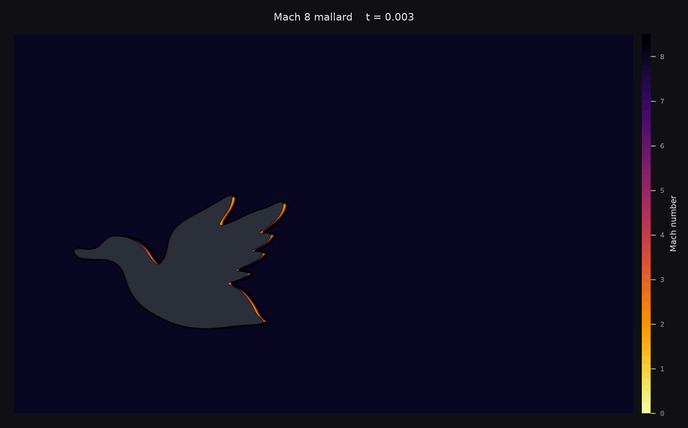

[](https://www.apache.org/licenses/LICENSE-2.0)
[](https://doi.org/10.5281/zenodo.23112953)


Mallard is a high-order unstructured finite volume solver for the compressible Euler and Navier-Stokes equations, written in C++ with [Kokkos](https://github.com/kokkos/kokkos) for performance portability.


*Configuration 3 of the 2D Riemann problem on 4096² quadrilaterals (16.8M cells), with Kelvin-Helmholtz roll-ups along the slip lines of the jet; a cellular detonation in 2H2-O2-7Ar in a 3 cm square duct, 19.2M hexahedra in a window that follows the front, whose transverse waves sweep both directions and print their tracks on the numerical soot foils of the walls (front speed within 0.2% of the Chapman-Jouguet speed); the Taylor-Green vortex at Re = 1600 on the full periodic box at 256³ (16.8M hexahedra), whose kinetic-energy dissipation rate, traced beside it, peaks within 0.3% of the 512³ spectral DNS of the [High-Order CFD Workshop](https://cfd.ku.edu/hiocfd/); and a DNS of the autoignition of thermally stratified lean H2/air at 41 atm (T' = 15 K, after Chen et al.), burning by spontaneous ignition fronts and deflagrations ([`examples/`](examples)).*

> **NOTE:** Mallard is under active development; finite-rate chemistry is new, and its GPU performance is still being tuned.

## Features

**Meshes**
- 2D (triangles, quadrilaterals) or 3D (tetrahedra, hexahedra, prisms, pyramids, mixed), chosen at build time
- Gmsh 2.2/4.1, CGNS, Fluent, OpenFOAM polyMesh or HDF5 mesh files (`mallard mesh convert`), scaled, rotated and translated on read, or generated boxes and annuli
- Periodic boundaries, translational or rotational (annular sectors: vectors turn across the seam): generated meshes, or paired zones of mesh files ([guide](docs/guide/meshes.md#rotational-periodicity))
- Axisymmetric (r-z) flows in 2D: revolved finite volumes, at design order up to the axis
- Curved high-order boundaries: Gmsh order-2/3 boundary elements or projection onto a circle, sphere or cylinder; TENO-E orders 3-6 converge at curved walls, where straight-sided faces do not ([guide](docs/guide/meshes.md#curved-boundaries))

**Numerics**
- Reconstruction: first order; MUSCL with Barth-Jespersen or Venkatakrishnan limiting; [TENO-E](https://doi.org/10.1007/s10915-025-02918-w) of orders 3 to 6, optionally bound preserving (measured orders 3-6 on triangles and quadrilaterals)
- Riemann solvers: Rusanov, HLL, HLLC, Roe and the rotated-hybrid HLL-Roe (RHLL), carbuncle-free except at shocks at rest on cell faces, all for single gases and mixtures
- Low-Mach correction of the upwind dissipation
- [What is new](docs/numerics/originality.md): TENO-E on every 3D cell type, with central stencils sized by a Lebesgue-constant bound and ranked in a mesh-spacing metric on thin cells; everything else is published methods, cited where used
- Explicit time integration (forward Euler, SSPRK3, RK4, low-storage SSPRK(5,4) and 2N RK4(5)) at a CFL number or a fixed step, or with embedded error-controlled steps

**Physics**
- Compressible Euler and Navier-Stokes; constant, Sutherland or power-law viscosity
- Thermally perfect multicomponent mixtures from [Cantera](https://cantera.org) YAML files; optional double-flux scheme for interfaces
- Finite-rate chemistry: elementary, three-body, falloff, PLOG and Chebyshev reactions; a Rosenbrock (RODAS) integrator per cell with analytical Jacobians, Strang or SIMPLER balanced splitting from the flow; ignition delays match Cantera up to 1268 species
- Mixture-averaged, unity-Lewis or constant-Lewis transport; optional thermal (Soret) diffusion
- Optically thin radiation (TNF Planck-mean model)
- Gravity and any number of source terms: expressions of position, time and the local or domain-averaged solution (species too), compiled for the GPU, in regions built from spheres, cylinders, cones, boxes, tori, polygons or implicit functions with unions, intersections and differences, with exact integrated totals on any mesh ([guide](docs/guide/sources.md), [regions](docs/guide/geometry.md#regions)); regions defined once by name and shared by sources, sponges and probes, the mesh's domain, boundary zones and cell zones as regions by name, and the boundaries and interiors of regions; region probes over surfaces and curves too, exact for primitives, clipped by filled regions and consistently oriented

**Large-eddy simulation** ([guide](docs/guide/les.md))
- Explicit LES: Sigma (default), WALE, Vreman or Smagorinsky eddy viscosity for single gases and mixtures, with Scotti's filter width on anisotropic cells and an opt-in dynamic constant
- Kinetic-energy-preserving hybrid convective flux, with the Riemann solver only at compressions, and a run-time dissipation budget that separates the model's, the scheme's and molecular dissipation
- Thickened flame (TFLES) with dynamic thickening and a dynamic efficiency (no model constant); partially stirred reactor (PaSR) closure, experimental
- Synthetic turbulent inflow: a digital filter with prescribed Reynolds stresses and length scales, or the statistics of a precursor run, bitwise the same on any number of ranks ([guide](docs/guide/boundary_conditions.md#synthetic-turbulence))
- Channel flow at Re<sub>τ</sub> = 395 and 590: Re<sub>τ</sub> within 0.7% and 1.6% of the DNS of Moser, Kim & Mansour
- Wall-modeled LES: the Griffin-Fu-Moin compressible model (isothermal and adiabatic walls) or an equilibrium ODE model, fed from an exchange point a few cells off the wall ([guide](docs/guide/les.md#wall-models-wall_model)); channels at Re<sub>τ</sub> = 2000 and 5200 on 12 cells per half-height with C<sub>f</sub> within 2.1% of Lee & Moser, and supersonic isothermal channels at M<sub>b</sub> = 1.7 and 3.0 with wall heat flux within 1.3% of Trettel & Larsson

**Boundary conditions**
- Slip, adiabatic, isothermal and heat-flux walls, optionally moving
- Inflow at a given velocity, mass flow, or stagnation pressure and temperature (thermally perfect mixtures included; [guide](docs/guide/boundary_conditions.md#stagnation-inlet)), characteristic far field, pressure outlets (local or area-averaged), transmissive, time-dependent expressions
- Partially non-reflecting characteristic (NSCBC) inlets and outlets with transverse terms (1% of an acoustic pulse reflected, against 97-99% at a fixed-pressure outlet); sponge layers of any expression or region
- Zones split between conditions by expressions

**Performance and parallelism**
- [Kokkos](https://github.com/kokkos/kokkos) backends: Serial, Threads, OpenMP, CUDA (NVIDIA) and HIP (AMD); double or single precision
- MPI with multi-jagged (cuboid blocks), Hilbert-curve or graph (dKaMinPar) partitions, GPU-aware halo exchange overlapped with computation: 93% (2D) and 91% (3D) weak-scaling efficiency on 16 A100 GPUs
- 50 million cell time steps per second on one A100 (fifth-order TENO-E, 2D Euler)
- No rank holds the whole mesh (HDF5 or generated meshes)
- Each rank finds the GPU next to its cores by itself and reports where it runs; job scripts for Slurm, PBS, Kubernetes and `mpirun` that resume from a restart after a time limit or preemption
- Bitwise-identical results on any number of threads or MPI ranks; restarts bit for bit, also on a different number of ranks
- Stiff chemistry on GPUs: a warp or wider team per cell and a sparse LU for large mechanisms, load-balanced across MPI ranks
- The whole time step as one CUDA graph; optional NCCL halo exchange; TENO-E setup on the GPU

**Input, output and diagnostics**
- TOML input with units (`p = "1 atm"`, `Lx = "5 mm"`), converted to SI and checked against each key's dimension; initial conditions, boundary states, sources and sponges as analytical expressions; misspelled or unused keys are errors, with suggestions; every error names the key and line, the fix and the docs page
- Pre-flight check (`mallard check`): mesh quality, stable time step, memory per GPU and cost estimate before a run
- Case templates (`mallard new <template>`): a ready-to-run case with mesh, run and post-processing scripts
- Stable inputs and files across releases: renamed keys keep working with a warning for a release and `mallard input upgrade` rewrites old inputs; restart, mesh and output files carry format versions, and files written since 0.6 are read by later releases
- Conservative, high-order remap of a restart onto another mesh (any cell type, resolution or rank count): exact cell intersections, integrals kept to rounding
- VTKHDF output for ParaView (default; one file per snapshot written by all ranks in parallel, or one file for the whole series; curved cells as quadratic cells), or VTU; surface output of boundary zones
- Running means and covariances; probes on points, curves and boundary zones (cell averages or high-order point values; wall shear, C_f, C_p, heat flux, y+ and fluxes through inlets and outlets; CSV, HDF5 or VTK, with integrals, means and extrema) and over regions (fraction-weighted integrals, means and extrema); domain integrals (kinetic energy, enstrophy, ...), wall forces
- Heat release, species production rates and detonation soot foils (`P_MAX`)
- A machine-readable JSON-lines run log, and provenance (code version, build, input and mesh hashes, resolved setup) and units (CF attributes in VTKHDF and HDF5, XDMF information, VTK field data, a CSV units line) in every output file
- `mallard reactor`, a 0D reactor, and Python tools for plotting, animation and VTKHDF and HDF5 output

**Run control** ([docs](docs/guide/running.md))
- Signals: `SIGUSR1` writes a restart and continues; `SIGTERM`, `SIGINT` or `SIGUSR2` write one and stop, on every rank after the same step and at no communication cost; works under `mpirun`, Slurm and Kubernetes grace periods
- `mallard ctl <run-dir> status | checkpoint | stop | set key=value` over a private Unix-domain socket: progress, throughput, ETA, memory and diagnostics; output intervals and stop conditions changed while running
- Divergence detected every step for free: the first invalid cells (variable, location, rank) are reported and the last valid state written

**Validation and testing**
- 40 [examples](examples) against exact solutions, theory, DNS or Cantera, e.g.:
  - Sphere wake at Re = 300: Strouhal number and drag within 3% and 2% of Johnson & Patel
  - Compressible isotropic turbulence: enstrophy within 2.4% of the filtered DNS of Johnsen et al.
  - CJ detonation speed within 0.01%; H2/air flame speeds within 0.81% of Cantera from φ = 0.6 to 1.4
- Over 500 unit and regression tests: exact Riemann solutions, design order, conservation, bitwise MPI and restart reproducibility; the [verification manual](https://matthewbonanni.github.io/mallard/docs/verification/) reports the measured order of 149 convergence studies, regenerated from the tests
- CI before every merge (2D, 3D, MPI on 1-4 ranks, single precision, GCC and Clang, warnings as errors; CUDA, HIP and SYCL compile checks for device code); fuzzing of the input and mesh readers; nightly sanitizers; a GPU performance suite with per-hardware baselines, tracked by merge on the [performance dashboard](https://matthewbonanni.github.io/mallard/docs/dashboard/)

The sources of every method and of the validation data are listed in [docs/references.md](docs/references.md).

## Building and installing

Three ways to install Mallard, quickest first:

| | Best for | Compiling |
|---|---|---|
| [Container](#container) (Docker, Apptainer, Kubernetes) | Trying Mallard; workstations; GPU nodes; Kubernetes clusters | None |
| [Spack](#spack) | Clusters: your compilers, MPI and GPUs | Automatic |
| [From source](#from-source) | Development; options the others lack | CMake |

Each installs the solvers `mallard2d` and `mallard3d`, the `mallard` command that runs whichever a case needs (by its mesh: a generated mesh is 3D when `[mesh]` sets `Nz` or `Lz`; `mallard --dim 2|3` states it), and, under `share/mallard`, the `examples`, `mechanisms`, `tools` and `tutorials`. One command does everything: `mallard -i input.toml` runs a case, `mallard check`, `new`, `ctl` and `input upgrade` help set it up and run it, `mallard reactor` integrates 0D reactors and `mallard mesh convert` writes meshes to HDF5; `mallard --help` lists them by purpose and `mallard <command> --help` explains each ([command line](docs/guide/cli.md)).

### Container

Each release, from 0.9.0 on, publishes images to the GitHub Container Registry:

| Image | For |
|---|---|
| `ghcr.io/matthewbonanni/mallard` (`:latest`, or a version: `:0.9.0`) | CPUs: OpenMP, MPI with dKaMinPar; x86-64 and ARM (also Apple Silicon) |
| `ghcr.io/matthewbonanni/mallard:cuda` (or `:0.9.0-cuda`) | NVIDIA GPUs: A100, A40 and RTX 30xx, L40S and RTX 40xx, H100 (driver R525 or newer); MPI with NCCL |

Both have HDF5, CGNS, zlib and the Python tools, and set `MALLARD_SHARE` to the examples' directory.

With Docker, run the Sod shock tube in the current directory:

```sh
docker run --rm -u "$(id -u):$(id -g)" -v "$PWD:/work" ghcr.io/matthewbonanni/mallard \
    bash -c 'cp -r $MALLARD_SHARE/examples $MALLARD_SHARE/mechanisms . && cd examples/sod && mallard -i input.toml'
```

and then any case, e.g. on 4 MPI ranks (`-it ... bash` for a shell in the container):

```sh
docker run --rm -u "$(id -u):$(id -g)" -v "$PWD:/work" -w /work/examples/riemann_2d ghcr.io/matthewbonanni/mallard \
    mpirun -n 4 mallard -i input.toml
```

On an NVIDIA GPU (with the [NVIDIA Container Toolkit](https://docs.nvidia.com/datacenter/cloud-native/container-toolkit/latest/install-guide.html)), add `--gpus all` and use the `cuda` image: `docker run --rm --gpus all ... ghcr.io/matthewbonanni/mallard:cuda ...`.

With Apptainer (or Singularity), which runs as you and mounts the current directory, on clusters too:

```sh
apptainer pull mallard.sif docker://ghcr.io/matthewbonanni/mallard
apptainer exec mallard.sif bash -c 'cp -r $MALLARD_SHARE/examples $MALLARD_SHARE/mechanisms .'
cd examples/sod && apptainer exec ../../mallard.sif mallard -i input.toml
```

For a GPU, pull `docker://ghcr.io/matthewbonanni/mallard:cuda` and add `--nv`: `apptainer exec --nv mallard-cuda.sif mallard -i input.toml`.

On Kubernetes, a `Job` runs a case on one GPU node with its files on a volume, and resumes from a restart file after preemption; an `MPIJob` ([Kubeflow MPI Operator](https://github.com/kubeflow/mpi-operator)) runs it across nodes, with the images' Open MPI in the launcher and the workers ([manifests and guide](docs/guide/running.md#kubernetes)). On clusters with their own MPI and no Kubernetes, run across nodes with Spack or a source build.

### Spack

[Spack](https://spack.io) (1.0 or newer) builds Mallard and its dependencies for your machine, with the package in this repository:

```sh
git clone --depth 1 https://github.com/spack/spack.git ~/spack && . ~/spack/share/spack/setup-env.sh
spack repo add --path spack/spack_repo/mallard https://github.com/MatthewBonanni/mallard.git
spack install mallard
spack load mallard
```

`spack repo add` also takes a local checkout's package repository, `spack repo add mallard/spack/spack_repo/mallard`; `spack repo update mallard` pulls a newer package. The default is OpenMP (C++ threads on macOS), MPI, HDF5, CGNS and zlib, in 2D and 3D, double precision. Other builds name their variants:

```sh
spack install mallard +cuda cuda_arch=80                 # NVIDIA A100 (90: H100)
spack install mallard +cuda cuda_arch=90 +nccl           # H100, halo exchanges with NCCL
spack install mallard +rocm amdgpu_target=gfx90a         # AMD MI250X (gfx942: MI300X)
spack install mallard ~mpi dims=3 precision=single       # one workstation, 3D only, single precision
spack install mallard ^openmpi@5                         # a particular MPI
```

| Variant | Default | Description |
|---|---|---|
| `dims` | `2,3` | Dimensions to build (`dims=3`: the 3D solver only) |
| `precision` | `double` | `double` or `single` |
| `openmp`, `threads`, `serial` | `+openmp` (macOS: `+threads`) | Kokkos host backend |
| `cuda` + `cuda_arch`, `rocm` + `amdgpu_target`, `sycl` | off | Kokkos GPU backend |
| `mpi`, `gpu_aware_mpi`, `nccl` | `+mpi` | MPI; device buffers to a GPU-aware MPI; halo exchanges with NCCL |
| `hdf5`, `cgns`, `zlib` | on | HDF5 meshes and output; CGNS meshes; zlib compression |

Spack builds its own Kokkos to match. A cluster's MPI, CUDA or compilers can be registered with `spack external find` (e.g. `spack external find openmpi cuda`). dKaMinPar is not in the package: build from source for `partitioner = "graph"`.

### From source

Mallard needs a C++20 compiler (GCC 10.4, Clang 14 or newer), CMake 3.22 or newer, and git. It depends on [Kokkos](https://github.com/kokkos/kokkos) (5.x), [toml11](https://github.com/ToruNiina/toml11) and [exprtk](https://github.com/ArashPartow/exprtk), all included in this repository (Kokkos and toml11 are submodules); CMake fetches yaml-cpp.

```sh
git clone --recursive https://github.com/MatthewBonanni/mallard.git
cd mallard
cmake -S . -B build -DCMAKE_BUILD_TYPE=Release -DUSE_SYSTEM_KOKKOS=OFF -DKokkos_ENABLE_THREADS=ON
cmake --build build -j
```

This builds the 2D solver, `build/src/mallard2d`, and `build/src/mallard`, which runs it. Add `-DMallard_DIM=3` (in a separate build directory) for the 3D solver, `mallard3d`; installed to the same prefix, one `mallard` runs both.

With everything (MPI with dKaMinPar, HDF5, CGNS and zlib), on Ubuntu 24.04, in 2D and 3D, installed into `~/mallard` (the CPU container is built this way):

```sh
sudo apt-get install -y build-essential cmake git libopenmpi-dev openmpi-bin libhdf5-openmpi-dev zlib1g-dev libtbb-dev
for dim in 2 3; do
    cmake -S . -B build-$dim -DCMAKE_BUILD_TYPE=Release -DUSE_SYSTEM_KOKKOS=OFF -DKokkos_ENABLE_OPENMP=ON \
        -DMallard_ENABLE_MPI=ON -DMallard_ENABLE_KAMINPAR=ON -DMallard_ENABLE_HDF5=ON \
        -DMallard_ENABLE_CGNS=ON -DUSE_SYSTEM_CGNS=OFF -DMallard_ENABLE_ZLIB=ON \
        -DMallard_DIM=$dim -DCMAKE_INSTALL_PREFIX=$HOME/mallard
    cmake --build build-$dim -j && cmake --install build-$dim
done
export PATH=$HOME/mallard/bin:$PATH MALLARD_SHARE=$HOME/mallard/share/mallard
```

On macOS with Homebrew, `brew install cmake open-mpi hdf5 cgns` and the same loop with `-DKokkos_ENABLE_THREADS=ON` in place of OpenMP, without dKaMinPar, and `-DUSE_SYSTEM_CGNS=ON`. `mallard test` runs the test suites of a build or an install (`mallard-test2d` and `mallard-test3d`, `--dim 2|3` for one), e.g. `mallard test --gtest_filter='Sod*'`.

Pick the Kokkos backend at configure time, for example `-DKokkos_ENABLE_OPENMP=ON`, or `-DKokkos_ENABLE_CUDA=ON -DKokkos_ARCH_AMPERE80=ON -DCMAKE_CXX_COMPILER=$PWD/src/external/kokkos/bin/nvcc_wrapper` for NVIDIA A100 GPUs (add `-DKokkos_ENABLE_OPENMP=ON` too, so host-side setup such as TENO's precomputation runs in parallel; with MPI, `-DMallard_ENABLE_NCCL=ON` for halo exchanges with NCCL). The CUDA container is built this way, for several GPUs at once (`docker/Dockerfile.cuda`). To use an installed Kokkos instead, pass `-DUSE_SYSTEM_KOKKOS=ON -DKokkos_DIR=/path/to/kokkos`.

For AMD GPUs, build with ROCm's Clang (ROCm 6.2 or newer, with the HIP development headers):

```sh
cmake -S . -B build-hip -DCMAKE_BUILD_TYPE=Release -DUSE_SYSTEM_KOKKOS=OFF \
    -DKokkos_ENABLE_HIP=ON -DKokkos_ARCH_AMD_GFX950=ON -DKokkos_ENABLE_OPENMP=ON \
    -DCMAKE_CXX_COMPILER=/opt/rocm/bin/amdclang++
```

`AMD_GFX950` is the MI350X/MI355X; use `AMD_GFX942` for the MI300X/MI300A or `AMD_GFX90A` for the MI250X. Instinct GPUs run 64-wide wavefronts where NVIDIA GPUs run 32-wide warps; the chemistry gives each cell a wavefront, and a team's results do not depend on its width. With MPI and dKaMinPar, also pass `-DCMAKE_POSITION_INDEPENDENT_CODE=ON`. On a node with automatic NUMA balancing on (`/proc/sys/kernel/numa_balancing` is 1), the ROCm driver stalls a process's GPU queues for up to seconds at a time: turn it off, as AMD recommends for Instinct GPUs, or bind each rank to its GPU's NUMA node (`numactl --cpunodebind=N --membind=N`).

| CMake option | Default | Description |
|---|---|---|
| `USE_SYSTEM_KOKKOS` | `ON` | Use an installed Kokkos instead of the submodule |
| `Mallard_DIM` | `2` | Spatial dimension, `2` or `3`: the solver `mallard2d` or `mallard3d` (one per build; `mallard` runs either) |
| `Mallard_USE_DOUBLE` | `ON` | Double precision (single precision otherwise) |
| `Mallard_ENABLE_MPI` | `OFF` | Distributed memory with MPI: `mpirun -n N mallard -i input.toml` splits the mesh between ranks; with generated meshes or HDF5 mesh files (`mallard mesh convert`) no rank ever holds the whole mesh, while other mesh files are read whole by every rank |
| `Mallard_GPU_AWARE_MPI` | `OFF` | With MPI on GPUs: hand device buffers to a CUDA- or ROCm-aware MPI (e.g. Open MPI over UCX built with CUDA or ROCm) instead of staging halos through host memory |
| `Mallard_ENABLE_NCCL` | `OFF` | With MPI on NVIDIA GPUs: exchange halos with NCCL, stream-ordered with the kernels, so the host never waits for a halo (finds NCCL through `NCCL_HOME` or `NCCL_ROOT`); `[parallel] halo_exchange` chooses at run time |
| `Mallard_ENABLE_KAMINPAR` | `OFF` | With MPI: the [dKaMinPar](https://github.com/KaHIP/KaMinPar) graph partitioner for `[parallel] partitioner = "graph"` (fetched at configure time; needs [oneTBB](https://github.com/uxlfoundation/oneTBB), found through `CMAKE_PREFIX_PATH`, e.g. built with `cmake -S oneTBB -B build -DTBB_TEST=OFF -DCMAKE_INSTALL_PREFIX=$HOME/tbb && cmake --build build -j && cmake --install build`). The default multi-jagged partitions need no library and cut box meshes at least as well. With CUDA, configure with the host compiler (`-DCMAKE_CXX_COMPILER=g++`) instead of `nvcc_wrapper`: Kokkos then compiles the code that uses it through `nvcc_wrapper` itself, and dKaMinPar does not compile with nvcc |
| `Mallard_ENABLE_HDF5` | `OFF` | HDF5 mesh files and solution output (`format = "hdf5"`, with XDMF for ParaView; parallel HDF5 with MPI, when available) and `mallard mesh convert` |
| `Mallard_ENABLE_ZLIB` | `OFF` | zlib compression of VTU and restart files (`[[write_data]] compression = "zlib"`; HDF5 output compresses with HDF5's own deflate filter and needs no option) |
| `Mallard_ENABLE_CGNS` | `OFF` | CGNS mesh files, through the [CGNS library](https://cgns.github.io/) (an installed one, found through `CMAKE_PREFIX_PATH`; with `-DUSE_SYSTEM_CGNS=OFF`, v4.5.0 is fetched and built with the HDF5 of `Mallard_ENABLE_HDF5`) |
| `Mallard_ENABLE_TESTS` | `ON` | Build the test suite, `mallard-test2d` or `mallard-test3d` (fetches GoogleTest) |
| `Mallard_INSTALL_TESTS` | `ON` | Install the test suite and its data, so that `mallard test` checks an installed build |
| `USE_SYSTEM_YAML_CPP` | `OFF` | Use an installed yaml-cpp (0.8 or newer) instead of fetching it |
| `Mallard_WARNINGS_AS_ERRORS` | `OFF` | Treat compiler warnings in Mallard's own code as errors (on in CI) |
| `BUILD_DOCS` | `OFF` | Doxygen documentation target |

## Running

```sh
cd examples/riemann_2d
mallard -i input.toml --kokkos-num-threads=8                   # installed (container, Spack)
../../build/src/mallard -i input.toml --kokkos-num-threads=8   # source build
```

or start a case of your own from one of the examples: `mallard new --list` shows the templates, and `mallard new cylinder` creates a directory with the input, mesh, run and plot scripts ([First simulation](docs/tutorials/first_simulation.md)). See the [tutorials](docs/tutorials/index.md) for cases taken from geometry and mesh to the comparison with reference data, [`examples/`](examples) for complete input files, [Running on clusters](docs/guide/parallel.md#running-on-clusters) for MPI runs and the job scripts in [`tools/jobs/`](tools/jobs), the [user guide](docs/guide/input_files.md) for each topic, and [`docs/input.md`](docs/input.md) for every input option.

Before a long run, `mallard check input.toml [--ranks N] [--throughput CELLS_PER_S]` runs the setup without time stepping and reports misspelled or unused keys, boundary zones without a condition, mesh quality with the worst cells, the stable time step and where it is set, memory per rank and the cost per unit simulated time ([details](docs/guide/input_files.md#checking-an-input)).

While it runs, `mallard ctl <run-dir> status` reports its progress and `mallard ctl <run-dir> stop` ends it with a restart ([run control](docs/guide/running.md)).

## Testing

```sh
mallard test                    # an install: every dimension installed (--dim 2|3 for one)
./build/src/mallard test        # a build tree (./build/test/mallard-test2d)
```

The test suite checks mesh geometry, the Riemann solvers against an exact Riemann solver, time integrator convergence orders, gradient and limiter properties, TENO design order on triangles and quadrilaterals and on 3D tetrahedra and hexahedra (with polynomial exactness on prisms, pyramids and mixed meshes), free-stream preservation, discrete conservation, symmetry preservation, shock tubes against exact solutions, viscous flows against exact solutions (Couette, Stokes' first problem, conduction), axisymmetric well balance and design order (manufactured solution, Hagen-Poiseuille), and bit-for-bit restarts.

## Postprocessing

`tools/` contains Python scripts (numpy, matplotlib, scipy, imageio) for reading Mallard's VTU files, plotting profiles against exact solutions, and rendering animations:

```sh
python tools/post/animate.py examples/riemann_2d/solut riemann
```

## Contributing

Bug reports, questions and pull requests are welcome. [CONTRIBUTING.md](CONTRIBUTING.md) covers building and testing, code style (the [Google C++ Style Guide](https://google.github.io/styleguide/cppguide.html), warnings as errors), how CI runs, and what a pull request includes: tests, documentation, an example and a [changelog fragment](changelog/README.md) for [CHANGELOG.md](CHANGELOG.md). Everyone taking part follows the [Code of Conduct](CODE_OF_CONDUCT.md).

## Citing

If you use Mallard, please cite it ([doi:10.5281/zenodo.23112953](https://doi.org/10.5281/zenodo.23112953), or the DOI of the version you used on Zenodo) with the metadata in [CITATION.cff](CITATION.cff) (GitHub's "Cite this repository" button), and the papers behind the methods you use ([docs/references.md](docs/references.md)).

## License

Mallard is licensed under the [Apache License, Version 2.0](LICENSE). Redistributions and derivative works must keep the attribution in [NOTICE](NOTICE). Versions 0.1.0 to 0.6.0 were released under the AGPL v3.0.

Mallard includes code and data derived from [Cantera](https://cantera.org) under the BSD 3-Clause License ([licenses/Cantera-BSD-3-Clause.txt](licenses/Cantera-BSD-3-Clause.txt)).

---

<p align="center">
  
  <br>
  <em>Mach 8 flow over a mallard: 1.07M triangles, TENO5 + RHLL (<a href="examples/mallard">examples/mallard</a>).</em>
</p>
