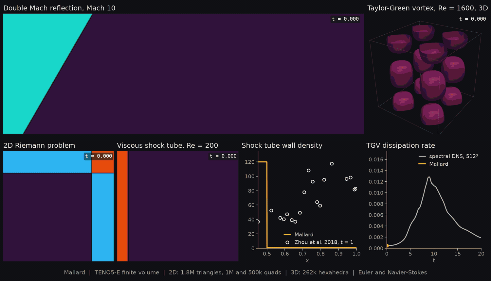
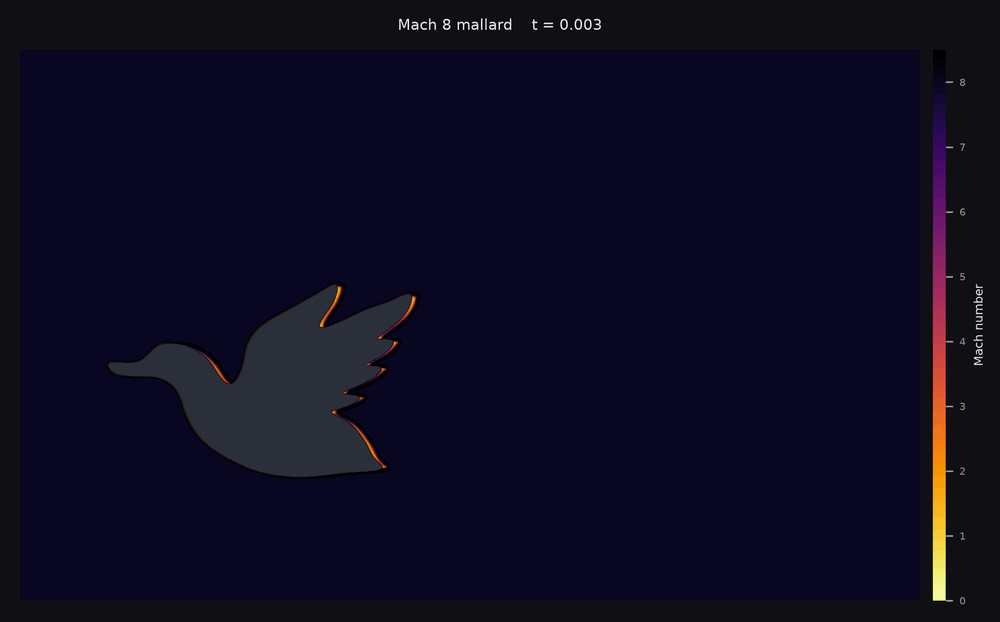

[](https://www.apache.org/licenses/LICENSE-2.0)
[](https://doi.org/10.5281/zenodo.23112953)


Mallard is a high-order unstructured finite volume solver for compressible Euler, Navier-Stokes and reacting flows, written in C++ with [Kokkos](https://github.com/kokkos/kokkos) to run on CPUs and NVIDIA and AMD GPUs.



*A 2D Riemann problem on 16.8M quadrilaterals; a cellular detonation in 2H2-O2-7Ar on 19.2M hexahedra, front speed within 0.2% of Chapman-Jouguet; the Taylor-Green vortex at Re = 1600 on 256³ hexahedra, peak dissipation within 0.3% of the spectral DNS; autoignition of stratified lean H2/air at 41 atm ([`examples/`](https://matthewbonanni.github.io/mallard/docs/examples/)).*

> **NOTE:** Mallard is under active development.

## Features

**Meshes** ([guide](https://matthewbonanni.github.io/mallard/docs/guide/meshes/))

- 2D: triangles, quadrilaterals; 3D: tetrahedra, hexahedra, prisms, pyramids, mixed
- Gmsh, CGNS, Fluent, OpenFOAM, HDF5; generated boxes and annuli
- Translational and rotational periodicity; axisymmetry
- Curved high-order boundaries

**Numerics** ([guide](https://matthewbonanni.github.io/mallard/docs/guide/numerics/))

- [TENO-E](https://doi.org/10.1007/s10915-025-02918-w) reconstruction, orders 3–6, every cell type ([what is original](https://matthewbonanni.github.io/mallard/docs/numerics/originality/))
- High order by default: equal accuracy at a fraction of second-order cost on smooth flow ([measured](https://matthewbonanni.github.io/mallard/docs/guide/numerics/#why-high-order))
- Riemann solvers: Rusanov, HLL, HLLC, Roe, RHLL; low-Mach correction
- Explicit Runge-Kutta: fixed CFL number or error-controlled steps

**Physics** ([guide](https://matthewbonanni.github.io/mallard/docs/guide/physics/))

- Compressible Euler and Navier-Stokes
- Thermally perfect mixtures; finite-rate chemistry from [Cantera](https://cantera.org) mechanisms
- Detailed transport, Soret diffusion, optically thin radiation
- Source terms and sponges as expressions over named [regions](https://matthewbonanni.github.io/mallard/docs/guide/geometry/#regions)
- Regions: arrays of copies, moving with `t`, wrapping across periodic boundaries, solution-defined (`T > 1500`, isosurfaces)
- Regions from watertight [STL and OBJ solids](https://matthewbonanni.github.io/mallard/docs/guide/geometry/#regions-from-cad-surfaces), in their drawing units

**Large-eddy simulation** ([guide](https://matthewbonanni.github.io/mallard/docs/guide/les/))

- Sigma, WALE, Vreman, Smagorinsky models; kinetic-energy-preserving hybrid flux
- Thickened flames with dynamic efficiency; synthetic turbulent inflow
- Wall models: Griffin-Fu-Moin compressible, equilibrium ODE

**Particles** ([guide](https://matthewbonanni.github.io/mallard/docs/guide/particles/))

- Lagrangian tracers on the high-order reconstructed velocity; pathlines at the scheme's spatial and integrator's temporal order
- Solid particles: Stokes, Schiller-Naumann, Singh et al. (compressible, rarefied) drag; gravity, pressure-gradient, added-mass, Saffman lift; Ranz-Marshall heat transfer
- Exponential integration of stiff particles; time step independent of particles
- Wall bounces with restitution, located within the step; deposition on sticking walls
- Path quantities: time integrals, extrema, first times, turns about an axis; particle probes over regions
- Two-way coupling: momentum and energy conserved to round-off; sources spread over a physical width; dispersed-phase fields ([guide](https://matthewbonanni.github.io/mallard/docs/guide/particles/#two-way-coupling))
- Injectors at points, boundary zones and regions; Rosin-Rammler, log-normal or tabulated sizes; same particles on any rank count ([guide](https://matthewbonanni.github.io/mallard/docs/guide/particles/#injectors))
- GPUs and MPI; bitwise identical on any rank count and across restarts

**Boundary conditions** ([guide](https://matthewbonanni.github.io/mallard/docs/guide/boundary_conditions/))

- Walls, inlets, outlets, far field, symmetry; composable options: NSCBC, averaging, turbulence, wall models
- Every value a number or an expression of x, y, z, t
- Profiles in boundary coordinates (wall distance, position along the boundary, radius, angle)
- Profiles from data files (tables, point clouds) in those coordinates

**Performance** ([guide](https://matthewbonanni.github.io/mallard/docs/guide/performance/))

- CPUs (OpenMP, threads), NVIDIA and AMD GPUs; single or double precision
- MPI: GPU-aware or NCCL halo exchange overlapped with computation; multi-jagged, Hilbert-curve or graph partitioning
- Whole time step as one CUDA graph
- Bitwise identical on any rank count; bitwise restarts

**Input and output** ([guide](https://matthewbonanni.github.io/mallard/docs/guide/input_files/))

- TOML input with units (`p = "1 atm"`); errors name the key, line and fix
- Initial states: expressions, layered regions, tables, divergence-free synthetic turbulence of a prescribed spectrum
- Command-line tools ([guide](https://matthewbonanni.github.io/mallard/docs/guide/cli/)):
    - `mallard check`: pre-run checks; mesh-quality and stencil fields for ParaView; every cell's stencils in one file; `--view` for an annotated image and ParaView file of domain, boundaries, regions
    - `mallard ctl`: steer a running job
    - `mallard diff`: compare two solutions
    - `mallard info`: inspect any output file
    - `mallard new`: case templates
    - `mallard pack`: one archive that reproduces a run; SHA-256 manifest, `--verify`
    - `mallard post average`: means, RMS, Reynolds and Favre covariances, plane averages, PDFs, conditional statistics
    - `mallard post convergence`: observed order, Richardson extrapolation, [grid convergence index](https://matthewbonanni.github.io/mallard/docs/guide/convergence/) across resolutions
    - `mallard post derive`: derived fields
    - `mallard post extract`: probes and region integrals from existing output
    - `mallard post flame`: premixed flame position, thermal thickness, consumption and displacement speeds
    - Tab completion: bash, zsh, fish
- Triggers on time, probes, forces, integrals: stop, write restart or snapshot, start or stop statistics, log, change a setting; steps land exactly on tested times
- [Run report](https://matthewbonanni.github.io/mallard/docs/guide/output/#run-report-reporthtml) `report.html` per run: outcome, configuration, health, monitor plots, cost, output; self-contained ([sample](https://matthewbonanni.github.io/mallard/docs/images/guide/run_report_sample.html))
- [Divergence report](https://matthewbonanni.github.io/mallard/docs/guide/running/#the-divergence-report) on failure: where, when, ranked likely causes with evidence, what to try
- VTKHDF output for ParaView
- [Derived fields](https://matthewbonanni.github.io/mallard/docs/guide/output/#derived-fields), in the run or via `mallard post derive`: Mach number, stagnation state, entropy, Q-criterion, λ₂, enstrophy, helicity, numerical schlieren, pressure coefficient; flames: mixture fraction, progress variable, flame index, scalar dissipation
- Probes on points, curves, surfaces, boundaries, regions
- Statistics, spectra, phase averages, PDFs, conditional statistics (on mixture fraction or progress variable)
- Initial-transient detection and confidence intervals (MSER-5, batch means): start statistics, stop at convergence
- [C++ API](https://matthewbonanni.github.io/mallard/docs/guide/cpp_api/): step a case from your program, same results as `mallard -i`; CMake package (`find_package(Mallard)`)
- [Python package](https://matthewbonanni.github.io/mallard/docs/guide/python/): output files as numpy arrays via Mallard's reader; post-processing commands as functions
- [Desktop GUI](https://github.com/MatthewBonanni/mallard-gui), in progress: case setup, runs, results

**Verification and validation** ([cases](https://matthewbonanni.github.io/mallard/validation/))

- 40 [examples](https://matthewbonanni.github.io/mallard/docs/examples/) vs exact solutions, other codes, DNS, experiments ([verification and validation cases](https://matthewbonanni.github.io/mallard/validation/))
- 1,600+ tests; [verification manual](https://matthewbonanni.github.io/mallard/docs/verification/) of measured convergence orders
- CPU and GPU CI before every merge; [performance dashboard](https://matthewbonanni.github.io/mallard/docs/dashboard/)
- Every method and reference cited in [docs/references.md](https://matthewbonanni.github.io/mallard/docs/references/)

## Installing

| | Best for |
|---|---|
| Container: `ghcr.io/matthewbonanni/mallard` (CPU) or `:cuda` (NVIDIA); Docker, Apptainer, Kubernetes | Trying Mallard; workstations; GPU nodes; Kubernetes |
| Relocatable Linux CPU archive, each release since 0.11.0 | Linux clusters with MPICH-based MPI; no container runtime |
| [Spack](https://spack.io): `spack install mallard` (this repository's package) | Clusters: your compilers, MPI, GPUs |
| From source with CMake | Development; every build option |

Quick CPU build:

```sh
git clone --recursive https://github.com/MatthewBonanni/mallard.git && cd mallard
cmake -S . -B build -DCMAKE_BUILD_TYPE=Release -DUSE_SYSTEM_KOKKOS=OFF -DKokkos_ENABLE_THREADS=ON
cmake --build build -j
```

- [Installation](https://matthewbonanni.github.io/mallard/docs/installation/): containers, relocatable archives, Spack, GPU and MPI builds, every CMake option
- [Supported platforms](https://matthewbonanni.github.io/mallard/docs/installation/#supported-platforms): GCC 15+, Clang 22+ or Xcode 26.4+; CMake 4.2+; Linux (x86-64, arm64), macOS; GPUs: CUDA 13.4, ROCm, oneAPI
- [Feature matrix](https://matthewbonanni.github.io/mallard/docs/guide/features/): which features combine (validated, verified, implemented, rejected, untested)

## Running

```sh
cd examples/riemann_2d
mallard -i input.toml --kokkos-num-threads=8                   # installed (container, archive, Spack)
../../build/src/mallard -i input.toml --kokkos-num-threads=8   # source build
```

- `mallard list templates`: ready-to-run templates; `mallard new cylinder` creates a case with mesh, run and plot scripts
- `mallard check input.toml`: check a case before a long run
- `mallard list fields|keys input.toml`: a case's output fields and input keys
- `mallard ctl <run-dir> status|stop`: steer a running case
- `mallard info solut`: what a run wrote
- `report.html`: open first
- `mallard test`: an install's test suites (`./build/src/mallard test` in a build tree)

Next:

- [Tutorials](https://matthewbonanni.github.io/mallard/docs/tutorials/): start here
- [`examples/`](https://matthewbonanni.github.io/mallard/docs/examples/): complete cases
- [User guide](https://matthewbonanni.github.io/mallard/docs/guide/input_files/): by topic
- [`docs/input.md`](https://matthewbonanni.github.io/mallard/docs/input/): every input key
- [Running on clusters](https://matthewbonanni.github.io/mallard/docs/guide/parallel/#running-on-clusters): MPI, job scripts
- [`tools/`](https://matthewbonanni.github.io/mallard/docs/tools/): plotting, animation
- [Python package](https://matthewbonanni.github.io/mallard/docs/guide/python/): your own analysis

## Contributing

- Bug reports, questions and pull requests welcome
- [CONTRIBUTING.md](https://matthewbonanni.github.io/mallard/docs/contributing/): building, testing, style ([Google C++ Style Guide](https://google.github.io/styleguide/cppguide.html), warnings as errors), CI
- Pull requests include tests, documentation, an example and a [changelog fragment](changelog/README.md) for [CHANGELOG.md](CHANGELOG.md)
- [Code of Conduct](CODE_OF_CONDUCT.md) applies to everyone

## Citing

- Mallard: [doi:10.5281/zenodo.23112953](https://doi.org/10.5281/zenodo.23112953) or your version's Zenodo DOI; metadata in [CITATION.cff](CITATION.cff) (GitHub's "Cite this repository")
- The papers behind the methods you use ([docs/references.md](https://matthewbonanni.github.io/mallard/docs/references/))

## License

- [Apache License, Version 2.0](LICENSE); redistributions and derivative works keep the attribution in [NOTICE](NOTICE)
- Versions 0.1.0–0.6.0: AGPL v3.0
- Code and data derived from [Cantera](https://cantera.org): BSD 3-Clause ([licenses/Cantera-BSD-3-Clause.txt](licenses/Cantera-BSD-3-Clause.txt))
- Expression language derived from [exprtk](https://www.partow.net/programming/exprtk/): MIT ([licenses/exprtk-MIT.txt](licenses/exprtk-MIT.txt))

---

<p align="center">
  
  <br>
  <em>Mach 8 flow over a mallard: 1.05M triangles, TENO5 + RHLL (<a href="examples/mallard">examples/mallard</a>).</em>
</p>
