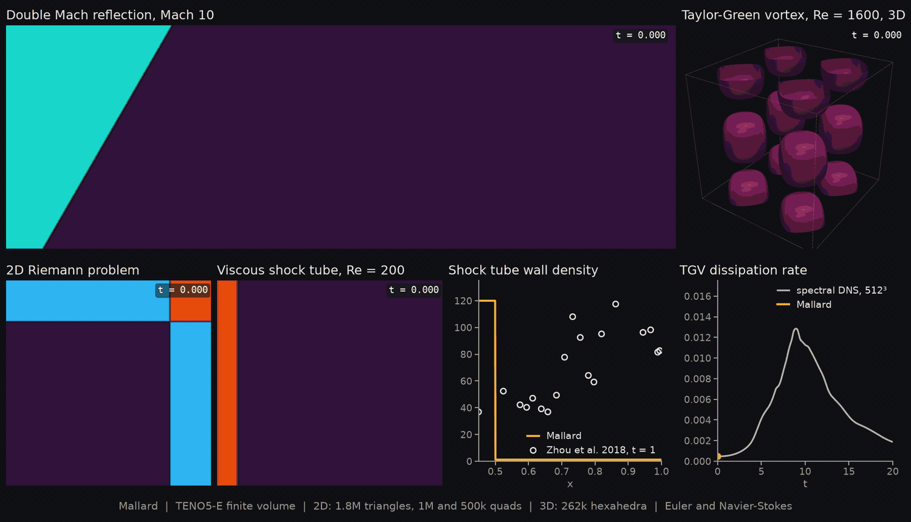
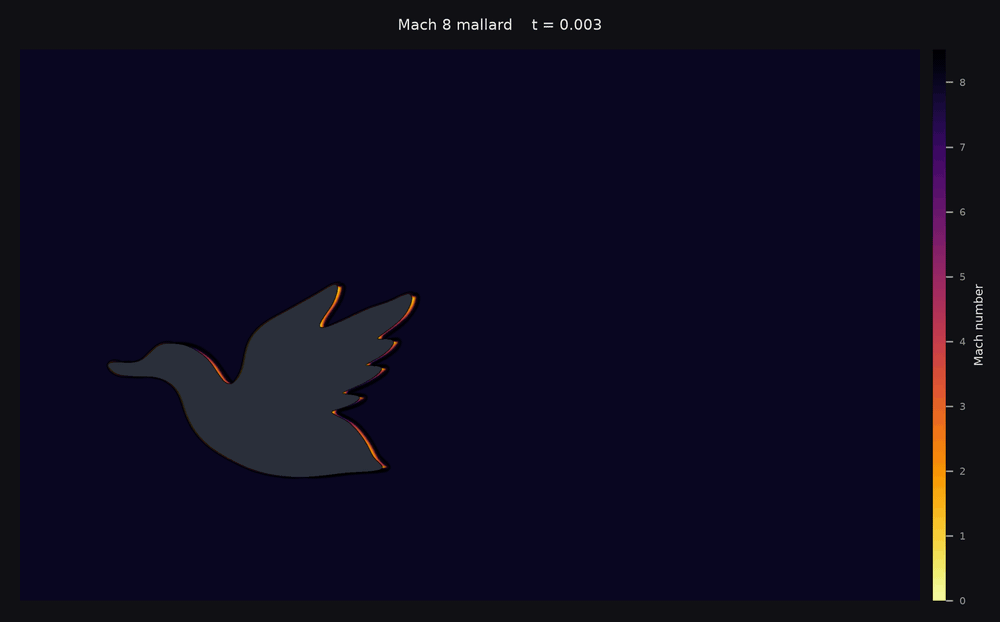

[](https://www.apache.org/licenses/LICENSE-2.0)
[](https://doi.org/10.5281/zenodo.23112953)


Mallard is a high-order unstructured finite volume solver for compressible Euler, Navier-Stokes and reacting flows, written in C++ with [Kokkos](https://github.com/kokkos/kokkos) to run on CPUs and NVIDIA and AMD GPUs.



*A 2D Riemann problem on 16.8M quadrilaterals; a cellular detonation in 2H2-O2-7Ar on 19.2M hexahedra, front speed within 0.2% of Chapman-Jouguet; the Taylor-Green vortex at Re = 1600 on 256³ hexahedra, peak dissipation within 0.3% of the spectral DNS; autoignition of stratified lean H2/air at 41 atm ([`examples/`](examples)).*

> **NOTE:** Mallard is under active development; finite-rate chemistry is new, and its GPU performance is still being tuned.

## Features

**Meshes** ([guide](docs/guide/meshes.md))
- 2D triangles and quadrilaterals; 3D tetrahedra, hexahedra, prisms, pyramids and mixed meshes
- Gmsh, CGNS, Fluent, OpenFOAM and HDF5 files, or generated boxes and annuli
- Translational and rotational periodicity; axisymmetric flows
- Curved high-order boundaries

**Numerics** ([guide](docs/guide/numerics.md))
- [TENO-E](https://doi.org/10.1007/s10915-025-02918-w) reconstruction, orders 3 to 6, on every cell type ([what is new](docs/numerics/originality.md))
- Rusanov, HLL, HLLC, Roe and RHLL Riemann solvers, with low-Mach correction
- Explicit Runge-Kutta, at a CFL number or with error-controlled steps

**Physics** ([guide](docs/guide/physics.md))
- Compressible Euler and Navier-Stokes
- Thermally perfect mixtures and finite-rate chemistry from [Cantera](https://cantera.org) mechanism files
- Detailed transport, Soret diffusion, optically thin radiation
- Source terms and sponges as expressions over named [regions](docs/guide/geometry.md#regions)

**Large-eddy simulation** ([guide](docs/guide/les.md))
- Sigma, WALE, Vreman and Smagorinsky models; kinetic-energy-preserving hybrid flux
- Thickened flames with dynamic efficiency; synthetic turbulent inflow
- Wall models: Griffin-Fu-Moin compressible and equilibrium ODE

**Boundary conditions** ([guide](docs/guide/boundary_conditions.md))
- Walls, inlets, outlets, far field and symmetry, with composable options (NSCBC, averaging, turbulence, wall models)
- Every value a number or an expression of x, y, z and t

**Performance** ([guide](docs/guide/performance.md))
- CPUs (OpenMP, threads) and NVIDIA and AMD GPUs; single or double precision
- MPI with GPU-aware or NCCL halo exchange overlapped with computation; multi-jagged, Hilbert-curve or graph partitions
- The whole time step as one CUDA graph
- Bitwise-identical results on any number of ranks; restarts bit for bit

**Input and output** ([guide](docs/guide/input_files.md))
- TOML input with units (`p = "1 atm"`); every error names the key, line and fix
- Initial states from expressions, layered regions, tables and divergence-free synthetic turbulence of a prescribed spectrum
- `mallard check` before a run, `mallard new` case templates, `mallard ctl` to steer a running job, `mallard info` on any output file, `mallard diff` between two solutions; tab completion for bash, zsh and fish
- Triggers: conditions on time, probes, forces and integrals that stop the run, write a restart or snapshot, or start statistics
- A [divergence report](docs/guide/running.md#the-divergence-report) when a run fails: where and when, the likely causes ranked with their evidence, and what to try
- VTKHDF output for ParaView
- Probes on points, curves, surfaces, boundaries and regions; statistics, spectra and phase averages

**Verification and validation** ([cases](https://matthewbonanni.github.io/mallard/validation/))
- 40 [examples](examples), compared with exact solutions, other codes, DNS and experiments
- Over 500 tests; a [verification manual](https://matthewbonanni.github.io/mallard/docs/verification/) of measured convergence orders
- CPU and GPU CI before every merge; a [performance dashboard](https://matthewbonanni.github.io/mallard/docs/dashboard/)

Every method and reference is cited in [docs/references.md](docs/references.md).

## Installing

| | Best for |
|---|---|
| Container: `ghcr.io/matthewbonanni/mallard` (CPU) or `:cuda` (NVIDIA GPUs) | Trying Mallard; workstations; GPU nodes; Kubernetes |
| [Spack](https://spack.io): `spack install mallard` with this repository's package | Clusters: your compilers, MPI and GPUs |
| From source with CMake | Development; every build option |

Quickest, on a CPU:

```sh
git clone --recursive https://github.com/MatthewBonanni/mallard.git && cd mallard
cmake -S . -B build -DCMAKE_BUILD_TYPE=Release -DUSE_SYSTEM_KOKKOS=OFF -DKokkos_ENABLE_THREADS=ON
cmake --build build -j
```

[Installation](docs/installation.md) covers containers, Spack, GPU and MPI builds and every CMake option; [supported platforms](docs/guide/support.md) lists what CI builds and runs.

## Running

```sh
cd examples/riemann_2d
mallard -i input.toml --kokkos-num-threads=8                   # installed (container, Spack)
../../build/src/mallard -i input.toml --kokkos-num-threads=8   # source build
```

`mallard list templates` shows ready-to-run templates (`mallard new cylinder` creates a case with its mesh, run and plot scripts), `mallard check input.toml` checks a case before a long run, and `mallard ctl <run-dir> status|stop` steers it while it runs; `mallard info solut` tells what a run wrote. Start with the [tutorials](docs/tutorials/index.md); see [`examples/`](examples) for complete cases, the [user guide](docs/guide/input_files.md) for each topic, [`docs/input.md`](docs/input.md) for every input key, [Running on clusters](docs/guide/parallel.md#running-on-clusters) for MPI and job scripts, and [`tools/`](tools) for plotting and animation.

`mallard test` runs the test suites of an install (`./build/src/mallard test` in a build tree).

## Contributing

Bug reports, questions and pull requests are welcome. [CONTRIBUTING.md](CONTRIBUTING.md) covers building and testing, code style (the [Google C++ Style Guide](https://google.github.io/styleguide/cppguide.html), warnings as errors), how CI runs, and what a pull request includes: tests, documentation, an example and a [changelog fragment](changelog/README.md) for [CHANGELOG.md](CHANGELOG.md). Everyone taking part follows the [Code of Conduct](CODE_OF_CONDUCT.md).

## Citing

If you use Mallard, please cite it ([doi:10.5281/zenodo.23112953](https://doi.org/10.5281/zenodo.23112953), or the DOI of the version you used on Zenodo) with the metadata in [CITATION.cff](CITATION.cff) (GitHub's "Cite this repository" button), and the papers behind the methods you use ([docs/references.md](docs/references.md)).

## License

Mallard is licensed under the [Apache License, Version 2.0](LICENSE). Redistributions and derivative works must keep the attribution in [NOTICE](NOTICE). Versions 0.1.0 to 0.6.0 were released under the AGPL v3.0.

Mallard includes code and data derived from [Cantera](https://cantera.org) under the BSD 3-Clause License ([licenses/Cantera-BSD-3-Clause.txt](licenses/Cantera-BSD-3-Clause.txt)), and an expression language derived from [exprtk](https://www.partow.net/programming/exprtk/) under the MIT License ([licenses/exprtk-MIT.txt](licenses/exprtk-MIT.txt)).

---

<p align="center">
  
  <br>
  <em>Mach 8 flow over a mallard: 1.05M triangles, TENO5 + RHLL (<a href="examples/mallard">examples/mallard</a>).</em>
</p>
