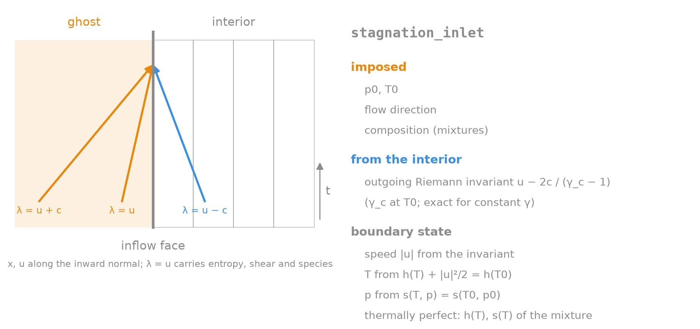
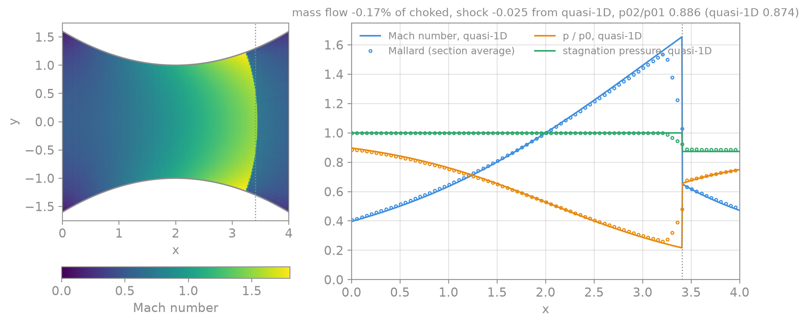

# Design: inlets

Status: implemented (`stagnation_inlet`).

`upt` imposes velocity, pressure and temperature, which over-specifies a
subsonic inflow: one characteristic, the acoustic wave travelling upstream,
leaves the domain through it. Nozzles, ducts and intakes need inlets that
impose only what the flow upstream sets and take the rest from the interior.

At a subsonic inflow face, with `u` the velocity along the inward normal,
four kinds of wave meet (five in 3D):

- `λ = u`: entropy, the tangential velocity and the composition, entering;
- `λ = u + c`: the incoming acoustic wave, entering;
- `λ = u − c`: the outgoing acoustic wave, from the interior.

An inlet imposes all but the last. Like every Mallard boundary, it does so
weakly: it builds a ghost state from the interior face state, and the Riemann
solver takes the flux between the two.

## `stagnation_inlet`



The inlet imposes the stagnation temperature `T0`, the stagnation pressure
`p0`, the flow direction `d` (by default the inward normal of each face) and,
for mixtures, the composition. The interior supplies the outgoing Riemann
invariant, which fixes the speed `V = |u|`:

```
J(W) = u_n + 2 c / (γ_c − 1),   c² = γ_c p / ρ     (u_n along the outward normal)
J(W_ghost) = J(W_interior),    u_ghost = V d
h(T) + V² / 2 = h(T0)          (energy)
s(T, p) = s(T0, p0)            (isentrope, at fixed composition)
```

For a calorically perfect gas, `h = cp T` and `p / p0 = (T / T0)^(γ / (γ − 1))`,
and `γ_c = γ`: this is the classical subsonic inflow condition (e.g.
Blazek, ch. 8).

For a thermally perfect mixture, the ghost state lies on the mixture's own
isentrope. `h(T)` is the mixture enthalpy from the NASA polynomials, and at
fixed composition

```
ln(p / p0) = (s°(T) − s°(T0)) / R
```

where `s°` is the mixture's standard-state entropy without the mixing term,
which cancels at fixed composition (`ThermoTable::s0_mass`). A constant ratio
of specific heats would put the state elsewhere. For air at `T0 = 2500 K`,
the frozen `γ(T0)` misses the true isentrope by more than 0.1% in pressure
already 300 K below `T0`. The unit tests integrate the isentrope from
`cp(T)` alone and check that a state on it is a fixed point of the inlet.

Only the invariant uses a constant `γ_c`, the frozen ratio at `T0`. It is the
same function of the state on both sides, so an interior state on the
isentrope is reproduced exactly, for any `γ(T)`. It only decides which
point of the isentrope is taken, not the total conditions.

`J(V)` is monotone along the isentrope. The solver brackets `T` in
`[10⁻³ T0, T0]` and runs a safeguarded Newton iteration in double precision
(about five iterations); for mixtures each iteration evaluates `h` and `cp`
of the inlet composition.

Special cases:

- **Outflow, or an interior above `p0`.** If `J` exceeds that of the
  stagnation state (`2 c0 / (γ_c − 1)`), the ghost is the stagnation state at
  rest. The Riemann solver then lets the flow out against `p0`.
- **Supersonic inflow** (`u_n ≤ −c`). Every wave enters, and none is left to
  fix the speed. The ghost keeps the interior speed, at `T0`, `p0` and `d`.
- **Supersonic outflow.** The ghost is the interior state.

### Reconstruction and the other paths

The ghost depends on the interior state, as `farfield`'s does:

- **Flux.** The face's reconstructed interior state goes in.
- **MUSCL gradients.** The cell state goes in, and the ghost counts as the
  value at the face centroid, as for `upt`.
- **TENO mirror cells.** These take the ghost of the mirrored cell.
- **Mixtures.** The inflow carries the inlet's composition in the species
  fluxes and their reconstruction. The ghost's frozen `[γ, e0]` are those at
  the ghost temperature. The surrogates in the scalar reconstruction stay the
  cell's own, since they vary with the ghost.
- **Viscous terms.** Viscous fluxes treat the inlet like `upt`: the cell's
  values and gradients.

### Verification

`test/inlet_test.cpp` checks:

- **Fixed point.** A perfect-gas interior on the isentrope at Mach 0.02,
  0.3 and 0.8 is reproduced to round-off, along the normal and oblique to it.
- **Conservation laws.** For an interior off the isentrope: the total
  enthalpy and the isentrope hold, the outgoing invariant is preserved, and
  the flow follows `d`. The backflow and supersonic cases are covered too.
- **Thermally perfect fixed point.** The same holds for air at `T0 = 2500 K`
  on its true isentrope, which a constant `γ` misses.
- **Equivalence with a perfect gas.** A one-species constant-`cp` mixture
  gives the perfect-gas flow to round-off.
- **Uniform duct.** Thermally perfect air from `T0 = 2000 K`, `p0 = 2 bar`
  to a 1.4 bar outlet, with MUSCL and TENO, settles at the exact isentropic
  exit state: velocity within 0.02%, temperature within 0.002%.
- **Nozzle.** The converging-diverging nozzle below, on a coarse mesh.
- **MPI.** A distributed run matches the serial one.

The `nozzle` example is a planar converging-diverging nozzle with inlet and
exit 1.6 throat heights, fed at `p0`, `T0`. The back pressure `0.75 p0` puts
a normal shock in the diverging part. `tools/plot_nozzle.py` compares the
section averages with the quasi-one-dimensional solution:



| | Mallard (320 × 20) | Quasi-1D |
|---|---|---|
| Mass flow / choked | 0.9983 | 1 |
| Shock position (section-averaged pressure) | 3.384 (2 cells upstream) | 3.409 |
| Stagnation pressure ahead of the shock | 1 ± 5e-4 | 1 |
| Stagnation pressure ratio across the shock | 0.886 | 0.874 |

The mass flow sits below the choked one because the sonic line of a planar
nozzle is curved; the quasi-1D theory has it straight. The shock is curved
too (it stands further upstream at the wall), and its section average is
weaker than the quasi-1D one: 1.4% less loss of stagnation pressure, which
moves it two cells upstream.
