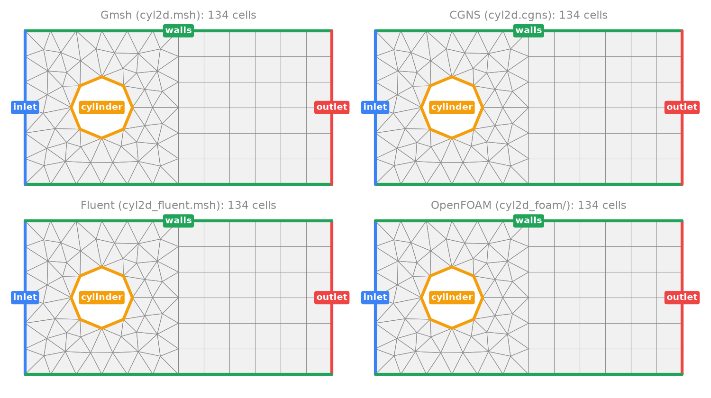
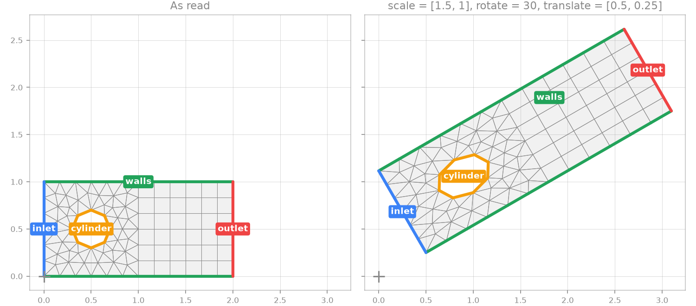

# Mesh import

Mallard reads meshes from Gmsh, CGNS, ANSYS Fluent and OpenFOAM, besides its
own HDF5 format (`[mesh] filename`, see the input reference). Every reader
produces the same thing: nodes, cells by their corners in Gmsh/VTK order,
and boundary faces with zone names. Mesh construction (faces, orientation,
periodic seams, partitioning) then does not depend on the format, and
`[mesh.transform]` maps the nodes before any of it.

The figure is Mallard's own read of one channel-and-cylinder mesh exported to
each format (cells, and boundary zones coloured and labelled): Gmsh writes the
`.msh` and `.cgns` files, OpenFOAM's `gmshToFoam` the polyMesh, and the 2D
Fluent file is written from Gmsh's elements. The tests check that every
format gives the same cells (centroids and volumes), faces and zones as the
Gmsh file, in 2D and 3D, ASCII and binary.

| Format | Cells | Boundary zones | Notes |
|---|---|---|---|
| Gmsh 2.2, 4.1 (ASCII) | Elements of the mesh dimension, any order (corners) | Physical curves (2D) or surfaces (3D) | High-order boundary elements curve faces |
| CGNS (unstructured; `Mallard_ENABLE_CGNS`) | Element sections, `MIXED`, any order (corners) | `BC_t` by family (`FamilyName`) or name; unlisted sections by name | Zones joined by `Abutting1to1` vertex connectivity; high-order faces curve |
| Fluent `.msh`, `.cas` (ASCII, binary) | Rebuilt from faces | Non-interior face zones, by their zone names | No polyhedra, no adapted (tree) meshes |
| OpenFOAM polyMesh (ASCII, binary) | Rebuilt from faces | Patches | 2D: one cell thick in z between `empty` patches |

Face-based formats (Fluent, OpenFOAM) list each cell only through its faces.
Mallard rebuilds the corners of triangles and quadrilaterals by chaining their
edges, and of tetrahedra, pyramids, prisms and hexahedra from their triangle
and quadrilateral faces (a prism's or hexahedron's opposite faces joined by
the edges between them), then checks each cell by regenerating its faces from
the corners and comparing them with the file's. A cell that is anything else
(a general polygon or polyhedron) is an error naming the cell and its faces.

## Transform on read

`[mesh.transform]` maps every node, `x -> R (S x) + t`: scale (per axis),
then rotate about the origin (marked +), then translate. High-order boundary
nodes are mapped too, so curved faces stay on the transformed curve. The
transform applies to mesh files only, serially and in distributed runs, and
everything else in the input (boundary conditions' geometry, probes,
`[[periodic]]` translations, `[[mesh.curved]]` shapes) refers to the
transformed mesh.

The figures come from `tools/render_mesh_import.py`, the fixtures from
`tools/make_import_meshes.py`.
