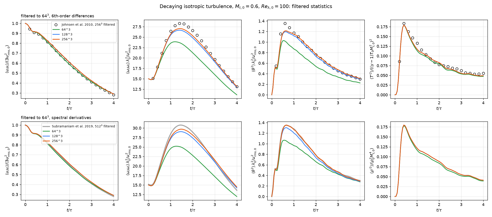

# Examples

Run each case from its own directory, e.g.

```sh
cd examples/riemann_2d
../../build/src/mallard -i input.toml --kokkos-num-threads=8
python ../../tools/post/animate.py solut riemann
```

Each example's `card.toml` gives its build (`2d`, `3d`) and what it demonstrates, for its card on the
website's [Examples](https://matthewbonanni.github.io/mallard/docs/examples/) page; the run times below name the
hardware they were measured on.

## Shocks and compressible flow

| Case | What it shows | Cells | Run time |
|---|---|---|---|
| `sod` | Sod shock tube with TENO5 on a 200x4 strip | 800 | seconds on 12 CPU threads |
| `shu_osher` | Mach 3 shock running into an entropy wave, the standard test for high-order schemes | 800 | seconds on 12 CPU threads |
| `riemann_2d` | 2D Riemann problem, configuration 3, on 320,000 triangles with TENO5 | 320,000 triangles | ~20 minutes on 12 CPU threads |
| `riemann_2d_quads` | The same problem on 160,000 quadrilaterals | 160,000 quads | ~9 minutes on 6 CPU threads |
| `riemann_2d_quads` (`coarse.toml`, `remap.toml`) | The same problem started on 10,000 quadrilaterals and continued from t = 0.5 on 131,072 triangles: `[initialize] type = "remap"` integrates the coarse run's degree-3 polynomials exactly over the triangles, conservatively and without new extrema (docs/design/remap.md) | 10,000 quads, then 131,072 triangles | seconds, then minutes on a few CPU threads |
| `double_mach` | Double Mach reflection of a Mach 10 shock: a split bottom boundary (inflow, then wall) and an exact moving shock on the top boundary | 460,000 triangles | ~1 hour on 12 CPU threads |
| `wedge` | Mach 1.76 flow over an 8 degree ramp; the oblique shock matches theory (p2/p1 = 1.498) | 19,200 quads | minutes on 12 CPU threads |
| `explosion_3d` | Spherical explosion (3D build): one octant with symmetry planes, TENO5 on 64³ hexahedra; the solution stays spherically symmetric | 262,144 hexahedra | ~5 minutes on 8 CPU threads |
| `rotational_sector` | Rotational periodicity: a swirling flow with azimuthal and radial waves in a quarter (90 degree sector) of an annulus (`sector.toml`), against the full annulus (`annulus.toml`), TENO5 between slip walls; `sector_3d.toml` and `annulus_3d.toml` are the 3D duct, also periodic along the axis. `examples/rotational_sector/rotational_sector.py` turns the sector into its four copies: the runs agree to rounding (TENO5 1e-10 after 110 steps with shocks, as the annulus agrees with itself; MUSCL 5e-14) | 4,096 and 16,384 quads (3D: 1,536 and 6,144 hexahedra) | about a minute on one CPU thread |
| `sedov_3d` | Sedov-Taylor point blast (3D build): one octant, bound-preserving TENO5 on 128³ hexahedra, against the exact similarity solution (`tools/setup/sedov.py`). The shock radius stays within 1-3% of `R = 1.0328 (E t^2 / rho0)^(1/5)` | 2.1M hexahedra | ~1.5 hours on four A100s |
| `sphere_mach3` | Mach 3 flow over a sphere (3D build) on an unstructured Gmsh tetrahedral mesh of the quarter domain (generate it with `examples/sphere_mach3/make_sphere_mesh.py`): HLL with bound-preserving TENO5. The bow-shock standoff settles at Delta / R = 0.226, 10% above Billig's correlation (0.205): 0.01 D, under half the tetrahedron edge length (0.025 D) in the shock layer | 800,000 tetrahedra | ~1.5 hours on four A100s |
| `mallard` | Mach 8 flow over a flying mallard from an impulsive start: RHLL with bound-preserving TENO5 on a Gmsh triangle mesh; generate the mesh with `examples/mallard/make_mallard_mesh.py` first | 1.05M cubic triangles | 89,000 steps: 1h 15m on one A100 |
| `nozzle` | Converging-diverging nozzle fed by a `inlet_stagnation` at p0, T0, with a normal shock in the diverging part; generate the mesh with `examples/nozzle/make_nozzle_mesh.py` first. Against the quasi-one-dimensional solution (`examples/nozzle/plot_nozzle.py`): mass flow 0.17% below the choked one, the shock two cells (0.6% of the length) upstream, the stagnation-pressure ratio across it 0.886 against 0.874 (the 2D shock is curved) | 6,400 quads | ~4 minutes on one CPU thread |
| `heated_duct` | Rayleigh flow: air at a fixed mass flux (`inlet_mass_flow`) heated on its way to a 1 bar outlet. Inlet pressure within 1e-5 and exit temperature within 1e-6 of Rayleigh flow; closed at the far end (`closed.toml`), the duct gains exactly `mdot t` while its inlet density rises 45%, where `inlet_state` (`closed_upt.toml`) lets the gas back out. `examples/heated_duct/plot_heated_duct.py` compares | 200 | seconds on one CPU thread |
| `heated_wall` | A closed box of air heated through its floor (`wall_heat_flux`, with a heat flux varying along it as an expression of x): the energy in the box grows by exactly the heat that entered, within 2e-14 of `q A t`, and each stretch of the floor takes up the integral of `q` over it within 0.3%. `examples/heated_wall/check_heated_wall.py` compares | 800 | seconds on one CPU thread |
| `average_outlet` | A supersonic core between subsonic streams leaving through `outlet_pressure` with `average = true`: the outlet's area-averaged pressure stays within 0.05% of the target while the pressure varies by 6% across it; a local outlet (`local.toml`) ends 2% above it. `examples/average_outlet/check_average_outlet.py` compares | 3,200 | seconds on one CPU thread |
| `shock_bubble_2d` | A Mach 1.22 shock on a light bubble and a heavy, tilted slab, set up without a script: the bubble from a tabulated radial density profile (`[[initialize.data]]`), the shocked gas and the slab as regions layered over it (`[[initialize.regions]]`), the slab's edges cutting the cells exactly | 57,600 quads | 40 s on 2 CPU threads |
| `forced_inlet` | A characteristic inlet forced in time (`u` and `T` as expressions of `t`, evaluated at every Runge-Kutta stage): 10% velocity pulsation at 1 kHz leaving as acoustic waves, 5% temperature pulsation at 250 Hz as entropy waves; the inlet cell follows both targets (amplitudes 5.02 and 14.96 against 5 and 15). `examples/forced_inlet/plot_forced_inlet.py` draws the x-t diagrams | 200 | seconds on one CPU thread |

## Axisymmetric flows

| Case | What it shows | Cells | Run time |
|---|---|---|---|
| `poiseuille_pipe` | Hagen-Poiseuille flow in a round pipe (axisymmetric), driven by a body force from rest: the steady profile converges to the exact one at second order (mean error 3.2e-4 U on 32 cells across the radius) | 128 quads | 1 minute on one CPU thread |
| `noh_axisymmetric` | Spherical Noh implosion on the meridian plane (axisymmetric, bound-preserving TENO5): shock radius within 1% of t / 3 in every direction, post-shock density 62-63 of the exact 64 (higher in the first cells along the axis, the usual overshoot at symmetry lines) | 40,000 quads | ~2 minutes on 4 CPU threads |
| `sedov_axisymmetric` | Sedov-Taylor blast as an axisymmetric run, against the exact solution (`tools/setup/sedov.py`): shock radius 0.6% ahead of R(t) at t = 0.8, spherical to 2% at the density peak | 65,536 quads | 5 minutes on one A100 |
| `sphere_axisymmetric` | Steady flow past a sphere at Re = 100 and 150 (axisymmetric, Mach 0.2) on a half O-grid from `tools/mesh/make_cylinder_mesh.py --half`: drag within 1.2% of the Clift-Grace-Weber correlation, separation angle within 0.2 degrees, wake length 0.885 D and 1.21 D (Johnson & Patel: 0.88, about 1.2); check with `examples/sphere_axisymmetric/plot_sphere_axisymmetric.py` | 16,384 quads | 285,000 viscous-limited steps: ~30 minutes on one A100 |
| `pulsed_jet` | A pulsed round jet from a nozzle in a wall launching a train of vortex rings (axisymmetric, Re_D = 2000, Mach 0.2): `where` splits the left wall into the nozzle, an `inlet_mass_flow` whose mass flux is an expression of `t`, and a `wall_adiabatic` around it; a smoothed square wave ejects a slug of L / D = 3 per period, below the formation number. At full size (six pulses, t U0 / D = 36) the inlet cell delivers strokes of 2.995 to 3.000 D against 3; the first ring travels at 0.40 U0 with 1.06 times the slug model's circulation, the next four, in its wake, at 0.454 to 0.463 U0 with 1.02 to 1.12 times. At D / 32 and Re_D = 1000 (two pulses, t U0 / D = 16) the inlet cell delivers strokes of 3.000 and 2.994 D against 3, the rings leave at 0.39 and 0.44 U0 (the second in the wake of the first) with 1.04 and 1.07 times the slug model's circulation. `examples/pulsed_jet/plot_pulsed_jet.py` tracks the rings and `animate_pulsed_jet.py` animates them | 442,368 quads (D / 96); 49,152 at D / 32 | 5 minutes on one A100; D / 32: 5 minutes on 2 CPU threads |

## Source terms

| Case | What it shows | Cells | Run time |
|---|---|---|---|
| `source_regions` | `[[sources]]` in regions: an annulus with a smooth edge releases a Gaussian heat pulse of exact total energy (`total = true`), a rotated rectangle pushes the gas with a body force and its work; a probe of the same named region records the mass and temperature in the ring, and probes of the mesh's region `domain` the total mass and the gas away from the ring | 51,200 triangles | ~2 minutes on 4 CPU threads |

## Viscous flows

| Case | What it shows | Cells | Run time |
|---|---|---|---|
| `viscous_shock_tube` | Daru & Tenaud viscous shock tube at Re = 200: shock / boundary-layer interaction in a closed box, giving a lambda shock and a primary vortex by t = 1. Matches the grid-converged wall density of Zhou et al. to 0.5 RMS; check with `examples/viscous_shock_tube/plot_viscous_shock_tube.py` | 500,000 quads | 58,500 viscous-limited steps: one GPU (or Nx = 500, Ny = 250: ~20 minutes on 6 CPU threads) |
| `cylinder` | Viscous flow past a cylinder at Re = 100 (vortex shedding) on a Gmsh O-grid; generate the mesh with `tools/mesh/make_cylinder_mesh.py` first. Reproduces St, Cd and lift amplitude to within 2% | 49,152 quads | ~50 minutes on a laptop CPU |
| `sphere_re300` | Viscous flow past a sphere at Re = 300 (3D build): periodic shedding of hairpin vortices, on a Gmsh mesh of prisms (boundary layer) and tetrahedra from `examples/sphere_re300/make_sphere_re300_mesh.py`; MUSCL. St = 0.133, Cd = 0.669, Cl = 0.073 against 0.137, 0.656, 0.069 (Johnson & Patel 1999), within 0.2%, 0.4% and 5% of a mesh with 2.4 times the cells | 850,000 cells | 1.04M steps: ~4.7 hours on four A100s |

## Turbulence

| Case | What it shows | Cells | Run time |
|---|---|---|---|
| `taylor_green_3d` | Taylor-Green vortex at Re = 1600 (3D build): the high-order workshop DNS case on the full periodic box [0, 2π]³. At 128³ the kinetic energy stays within 2.6% of the 512³ spectral DNS and the dissipation peak is 0.01161 at t = 8.4 (10% low and early); at 256³ it is 0.01289 at t = 8.8, against 0.01286 at t = 9.0 for the DNS | 2,097,152 hexahedra | 12,900 steps: ~45 minutes on 4 A100s |
| `taylor_green_3d` (`coarse.toml`, `remap.toml`) | The vortex on 16³ hexahedra of the periodic box to t = 3, continued on 32³ by `[initialize] type = "remap"`: the remap keeps mass, momentum and energy to 4e-14 in 0.6 s, and the finer mesh's dissipation catches up with that of a 32³ run from t = 0 by t = 7 (docs/design/remap.md) | 4,096 then 32,768 hexahedra | 8 s then ~7 minutes on 2 CPU threads |
| `isotropic_turbulence` | Decaying compressible isotropic turbulence with eddy shocklets (3D build), the case of Johnsen et al. (2010): M<sub>t</sub> = 0.6, Re<sub>λ</sub> = 100, k0 = 4 on the periodic box, as DNS on 64³, 128³ and 256³ hexahedra (TENO5) from the same random initial field (`tools/setup/isotropic_turbulence_restart.py`). At 256³ (k<sub>max</sub>η ≥ 2.7) kinetic energy, temperature and density variances are grid-converged to 0.3% and the enstrophy to 3%; filtered to 64³ as the references, the enstrophy is within 2.4% (mean) of Johnsen et al.'s filtered 256³ and 0.3% of Subramaniam et al.'s filtered 512³, the dilatation variance within 0.6%. `examples/isotropic_turbulence/isotropic_turbulence_stats.py`, `plot_isotropic_turbulence.py` and `animate_isotropic_turbulence.py` analyze and animate it; details in the input's header | 16.8M hexahedra (128³: 2.1M) | 4,307 steps: about an hour on 12 A100s (128³: 17 minutes on 3) |
| `channel_retau180` | Turbulent channel flow at Re<sub>τ</sub> = 180 (3D build): DNS at bulk Mach 0.2 between isothermal walls, periodic in x and z, on the 4πh × 2h × 4πh/3 box of Moser, Kim & Mansour (1999), with the mass flow held by `[source] mass_flow` and a tanh-stretched generated mesh (`[mesh] stretching`); MUSCL with the kinetic-energy-preserving `hybrid` convective flux, and the kinetic-energy budget of `[integrals]` (numerical dissipation 0.9% of the total). Generate the initial state with `tools/setup/channel_init.py`; `[statistics]`, `tools/post/plane_average.py` and `tools/post/plot_channel.py` compare the profiles with MKM, `examples/channel_retau180/animate_channel.py` animates the near-wall vortices. Over 12.9 h/u<sub>τ</sub>: Re<sub>τ</sub> = 180.8 against 178.1 (Cf 2.0% high), the RMS velocity and -u'v' peaks within 2%. The input's header lists the alternatives: HLLC at every face gives Cf 7% low on this mesh (its upwind dissipation is 7% of the total) and reaches MKM only on a mesh twice as fine in x and z | 2.36M hexahedra (dx+ = 11.8, dz+ = 5.9, dy+ = 0.88 at the wall) | 489,000 steps: 2.3 hours on two A100s |
| `channel_inflow_retau180` | Spatially developing turbulent channel at Re<sub>τ</sub> = 180 (3D build): DNS with digital-filter synthetic turbulence at an `inlet_state` with `nscbc`, its mean profile and Reynolds stresses taken from the periodic `channel_retau180` statistics (`inflow_profile.csv`). Wall shear, -u'v' and the RMS peaks recover to within 5% of the periodic channel by about 17h (Keating et al. 2004: about 20h); the outlet uses `beta = 0` behind a sponge. Start from the periodic example's restart with `tools/setup/tile_restart.py` (see the input's header) | 4.7M hexahedra | 337,000 steps: 2.5 hours on four A100s |
| `turbulent_inflow_duct` | Isotropic digital-filter turbulence (u′ = 0.1 U, L = 0.25, Re_L = 100) entering a duct periodic across and decaying downstream (3D build): inlet Reynolds stresses within 6% of target, and `zero_net_flux` removing the plane acoustic wave (spurious p′<sub>rms</sub> = 7.8 ρu′² without it, 1.1 by x = 20L with it) | 6.3M hexahedra | 65,000 steps: 1.5 hours on one A100 |
| `forced_isotropic_turbulence` | Linear forcing of turbulence held at a target kinetic energy (3D build): a `[[sources]]` entry reading the domain average `mean_ke` controls the forcing rate, so the kinetic energy stays within 1.3% of its target (0.1234-0.1248 for 0.125) through t = 20 while the Taylor-Green vortex it starts from breaks down; unforced it falls to 0.012 | 32³ = 32,768 hexahedra | 3,266 steps: 20 s on one A100 |

### Isotropic turbulence: filtered statistics



`isotropic_turbulence` on $64^3$, $128^3$ and $256^3$, filtered to $64^3$ as the
references: top, sixth-order differences against Johnsen et al. (2010,
circles); bottom, spectral derivatives against Subramaniam et al. (2019,
grey). $64^3$ is under-resolved ($k_\mathrm{max}\eta \approx 0.7$) and misses 15% of the
enstrophy; $128^3$ and $256^3$ agree within 2%. The remaining differences from
the references (kinetic energy +2%, temperature variance -5%) are of the size
of the spread between random initial fields, whose realizations the
references do not publish.

## Large-eddy simulation

| Case | What it shows | Cells | Run time |
|---|---|---|---|
| `cbc_les` | Large-eddy simulation of decaying grid turbulence (Comte-Bellot & Corrsin 1971; 3D build) with the Sigma model and the hybrid KEEP/HLLC flux on 32³ to 128³ hexahedra (`examples/cbc_les/cbc_les.py`): spectra within 0.06-0.09 decades RMS of the measurements at 128³ (and at 64³ with `C = 1.8`), with 1-2% of the dissipation numerical; model off, the energy piles up at the grid cutoff; with HLLC alone, 84% of the dissipation is numerical. Details in the input's header and `docs/design/les.md` | 262,144 hexahedra | 2,035 steps: 3 minutes on 4 CPU threads |
| `channel_les` | Wall-resolved LES of turbulent channel flow at Re<sub>τ</sub> = 395 (3D build) against Moser, Kim & Mansour (1999): Sigma model with Scotti's filter width, hybrid KEEP/HLLC flux, 64³ hexahedra. Re<sub>τ</sub> within 0.7% (2.6% with `Delta = V^(1/3)`) against 7.1% without the model; mean velocity within 3% for y+ = 30-300; 3-5% of the dissipation numerical. Details in the input's header and `docs/design/les.md` | 262,144 hexahedra | 857,000 steps: 65 minutes on one A100 |
| `channel_les` (`input_590.toml`) | The same LES at Re<sub>τ</sub> = 590 (96³): Re<sub>τ</sub> within 1.6% of MKM with the Sigma model (Scotti's width), 4.1% with `V^(1/3)`, 7.8% without a model; 3% of the dissipation numerical. Details in the input's header and `docs/design/les.md` | 884,736 hexahedra | about 900,000 steps: 3.5 hours on one A100 |
| `channel_wmles` | Wall-modeled LES of channels (3D build) on 12 cells per half-height, with the Griffin-Fu-Moin and the equilibrium ODE wall models: Lee & Moser at Re<sub>τ</sub> = 2000 and 5200 (`lm2000.toml`, `lm5200.toml`; C<sub>f</sub> within 2.1%) and the supersonic isothermal channels of Trettel & Larsson at M<sub>b</sub> = 1.7 and 3.0 (`tl_m1.7.toml`, `tl_m3.0.toml`; wall heat flux within 1.3% and centerline temperature within 0.7% with GFM, Re<sub>τ</sub> within 2.9-3.9%). `examples/channel_wmles/wmles_channel.py` makes the initial state and compares; details in the headers and `docs/design/wall_model.md` | 62,208 hexahedra | 32,000-256,000 steps: 5-25 minutes on one A100 |
| `volvo_bluff_body` | LES of the Volvo bluff-body combustor (Sjunnesson et al.; 3D build), non-reacting (`cold.toml`): Sigma, hybrid flux, digital-filter inflow and NSCBC outlet on a Gmsh hexahedral mesh from `examples/volvo_bluff_body/make_volvo_mesh.py`. Recirculation length 1.34 D against 1.35 D measured, RMS axial velocity within 0.08 U<sub>b</sub> and mean within 0.14 U<sub>b</sub> (0.08 downstream of x/D = 3.75) at the five LDA stations; `eps_num / eps_sgs` = -0.38. `reacting.toml` (propane-air with `mechanisms/c3h8_2step.yaml`, TFLES) is set up but not validated: details in the headers and `docs/design/les.md`, section 8.3 | 2.7M hexahedra | 626,000 steps: 2.8 hours on four A100s |
| `flame_turbulence` | Premixed H2/air flame in decaying turbulence (3D build): DNS reference (`input.toml`, 224 x 128 x 128, u′ = 2.1 S<sub>L</sub>, Ka = 2) and its LES with the thickened flame model (`les.toml`, Delta = 0.8 delta_L, F = 4): turbulent flame speed within 6-9% of the DNS with the default dynamic efficiency, and within 8-14% at Delta = 1.6 delta_L, where Colin's efficiency (`efficiency = "charlette"`) doubles it. Details in the headers and `docs/design/les.md`, section 8.3 | DNS 3.7M, LES 15,360 hexahedra | DNS 67,000 steps: 6-8 hours on 3-4 A100s; LES 7,044 steps: under a minute on one A100 |

## Reacting flows and mixtures

| Case | What it shows | Cells | Run time |
|---|---|---|---|
| `h2_ignition` | Constant-volume ignition of stoichiometric H2/air at 1200 K, 1 atm with `mallard reactor` (`../../build/src/mallard reactor -i input.toml`, writes `reactor.csv`); ignition delay 44.2 us as Cantera | 0D | milliseconds on one CPU thread |
| `reactive_shock_tube` | Reactive shock tube in 2H2-O2-7Ar (Fedkiw et al. 1997; Martinez Ferrer et al. 2014): the gas behind the reflected shock ignites and a detonation overtakes the reflected shock; the front at 230 us converges to 99.6 mm under refinement | 2,400 (50 um); 4,800 and 9,600 for the convergence check | minutes on a few CPU threads |
| `detonation_1d` | Planar CJ detonation in 2H2-O2-7Ar at 6.67 kPa, started from its ZND structure (generate it with `tools/setup/detonation_reference.py` and `tools/setup/znd_restart.py`, see the input's header): the front keeps D_CJ = 1617 m/s within 0.01% at 20 cells per induction length, and the von Neumann pressure | 3,934 (10 per induction length); 7,868 and 15,736 for 20 and 40 | minutes on a few CPU threads |
| `detonation_2d` | Cellular detonation in 2H2-O2-7Ar at 6.67 kPa (V9): the ZND detonation of `detonation_1d` in a 6 cm channel, perturbed by six pockets of fresh gas, with the numerical soot foil (`P_MAX`); generate the initial state first (see the input's header). Front speed 1617.0 m/s (D_CJ to 0.01%); eight triple points (15 mm cells) thin out to 3 cm cells and fainter tracks over 33 cm of travel; the track pattern is the same at 10 and 20 cells per induction length. `examples/detonation_2d/soot_foil.py` and `examples/detonation_2d/animate_detonation_2d.py` analyze and animate it | 1.2M | 18,900 steps: 39 minutes on two A100s |
| `detonation_3d` | Cellular detonation in a 3 cm square duct (3D build), 2H2-O2-7Ar at 6.67 kPa at 10 cells per induction length, in a window that follows the front (`examples/detonation_3d/detonation_window.py`), started from a 2D cellular detonation (`input_2d.toml`) turned into in-phase transverse waves in y and z: the rectangular mode with numerical soot foils on all four walls, triple-point tracks and slapping-wave bands; front speed D_CJ to 0.2% over 17 cm. `examples/detonation_3d/soot_foil_3d.py` and `examples/detonation_3d/animate_detonation_3d.py` analyze and animate it | 19.2M hexahedra | 12,180 steps: 4.6 hours on four A100s |
| `premixed_flame` | Freely propagating stoichiometric H2/air flame at 1 atm with mixture-averaged transport (V8), started from Cantera's flame in its frame (generate the restart file first, see the input's header); the consumption speed settles within 0.1% of Cantera's 2.332 m/s | 300 (20 per thermal thickness) | ~10 minutes on one CPU thread |
| `premixed_flame/ch4` | Freely propagating stoichiometric CH4/air flame (GRI-3.0, 53 species) at 1 atm with mixture-averaged transport (V8), started from Cantera's flame in its frame (generate the restart file first, see the input's header); the consumption speed settles 1.3% below Cantera's 0.3758 m/s. `examples/premixed_flame/flame_sweep.py` runs the sweep over φ = 0.6-1.4, both transport models, resolution and CFL | 300 (20 per thermal thickness) | 445,000 steps: about 2 hours on one A100 |
| `flame_outflow` | A stoichiometric H2/air flame blown out through a characteristic outlet, fed by a characteristic inlet: while the flame leaves, the pressure stays within 0.7% of the target and within 0.3% across the domain | 60 | ~2 minutes on 3 CPU threads |
| `flame_2d` | Lean H2/air flame (φ 0.4, 700 K, 1 atm) in a periodic channel with mixture-averaged transport and, in `unity/`, unity Lewis numbers, from the same wrinkled front: differential diffusion makes the burnt gas 0.96-1.02 times the adiabatic flame temperature (unity Lewis: uniform) and the flame up to 14% faster; planar flames on the same mesh are within 0.6% of Cantera. Generate the initial states first (see the input's header); `examples/flame_2d/animate_flame_2d.py` animates both side by side | 72,576 | 300,000-380,000 steps: 70-80 minutes per run on one A100 |
| `counterflow_diffusion` | H2/N2 (1:3) against air from opposed round jets, 10 mm apart (V10, 3D build): a quarter domain with N2 coflows, started from Cantera's `CounterflowDiffusionFlame` (generate the mesh and initial state first, see the input's header and `README.md`). Peak temperature against local strain rate within 2% of Cantera's from 344 to 1640 1/s (+0.49% at this input's 711 1/s), within 0.6% at matched flame strain; it goes out between 1818 and about 1975 1/s (Cantera: 1816 1/s) | 46,464 hexahedra (15 per flame width) | 75 minutes on one A100 |
| `triple_flame` | Triple flame of H2:N2 = 1:1 against air at 300 K (mixture-averaged transport) in mixing layers of 4 and, in `thick/`, 12 thermal thicknesses, against Ruetsch, Vervisch & Liñán (1995): held in place by raising the inflow to its speed, it propagates at U<sub>F</sub> / S<sub>L</sub> = 2.31 and 2.46 at local mixing thicknesses D<sub>TF</sub> = 9 and 28, rising with D<sub>TF</sub> as theirs (1.23 to 1.51); higher than their one-step, unity-Lewis values because the hydrogen tip burns at 1.24-1.30 S<sub>L</sub>, while the flow divergence alone gives 1.86-1.90, below √(ρ<sub>u</sub>/ρ<sub>b</sub>) = 2.44. Generate the initial states first (see the input's header); `examples/triple_flame/triple_flame_analysis.py` and `examples/triple_flame/animate_triple_flame.py` analyze and animate it | 166,000 and 276,000 (12 per thermal thickness) | about 330,000 steps: 4 hours per run on two A100s |
| `flame_vortex` | Premixed flame-vortex interactions on the spectral diagram of Poinsot, Veynante & Candel (1991): vortex pairs of 1-8 thermal thicknesses at 3-100 S<sub>L</sub> against a rich H2/air flame (φ = 4, deficient-reactant Lewis number 2.2, no heat losses). Small pairs fall below the 5% cut-off, larger ones wrinkle the front or cut off pockets of fresh gas, and none quenches, up to Ka(r) = 25 (Poinsot et al.'s quenching needs heat losses: see `flame_vortex_quenching`). Generate the initial state first (see the input's header); `examples/flame_vortex/flame_vortex_analysis.py` classifies the runs and `examples/flame_vortex/animate_flame_vortex.py` animates them | 26,000-85,000 (12 per thermal thickness, 24 for the smallest pairs) | 12 minutes to 1.5 hours per run on one A100 |
| `flame_vortex_quenching` | The spectral diagram of Poinsot, Veynante & Candel (1991) with heat losses: vortex pairs of 1-8 thermal thicknesses at 3-100 S<sub>L</sub> against a lean CH4/air flame near its radiative limit (φ = 0.42, two-step mechanism, optically thin radiation `[radiation]`). Pairs above a quenching line (Ka(r) between 1.25 and 5 for r = 8 delta_L, rising steeply toward small pairs) cut off a pocket whose downstream side goes out in the radiatively cooled burnt gas, as in their quenching example; the same pair at φ = 0.44 or without radiation leaves a pocket that burns out. Generate the initial state first (see the input's header) | 26,000-106,000 (12 per thermal thickness, 24 for the smallest pairs) | 1-4.5 hours per run on one A100 |
| `autoignition_2d` | Autoignition of a thermally stratified lean H2/air mixture at constant volume (φ 0.1, 1070 K, 41 atm; Chen et al. and Hawkes et al. 2006, Sankaran et al. 2005): a 4.1 mm periodic square with random temperature fluctuations T' of 3.75-30 K and decaying turbulence, mixture-averaged transport, 11-15 cells per deflagration thickness. Generate the initial state and the 0D references first (see the input's header). Larger T' ignites earlier (mean heat release peak at 0.99 down to 0.82 tau_0) and burns longer (width 0.06 to 0.16 tau_0), and the fronts slow from spontaneous ignition (median 17 S<sub>L</sub>) towards deflagration (2.4 S<sub>L</sub>, a quarter of the heat release below 1.5 S<sub>L</sub>); the multizone model without transport predicts 2-4 times wider bursts, since mixing halves T' before ignition. `examples/autoignition_2d/autoignition_analysis.py` and `examples/autoignition_2d/animate_autoignition.py` compare and animate the runs | 160,000 | 1.4-2.0M steps per T': 4.7-5.5 hours on four A100s |
| `shock_bubble_3d` | Mach 1.25 shock on a helium bubble in air (3D build; Haas & Sturtevant 1987): Navier-Stokes with mixture-averaged transport at Re = 1.5e3 (the bubble scaled down to 0.18 mm), a quarter of the square shock tube at 128 cells per diameter; the kidney-shaped bubble, the air jet and the vortex ring. Refracted and transmitted shocks, ring and late downstream face within 0-8% of the measured velocities (961, 359, 178, 166 m/s against 960, 365, 165, 165), all within 1.2% at 96 cells per diameter; generate the initial state first (see the input's header); `examples/shock_bubble_3d/shock_bubble.py` compares, `examples/shock_bubble_3d/animate_shock_bubble.py` animates | 11.4M hexahedra | 52,091 steps: 3.4 hours on four A100s |

