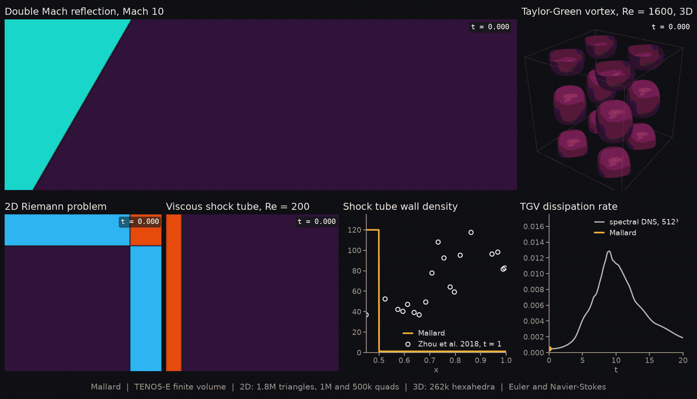

# Tools

Mallard comes with three executables and a set of Python scripts that cover every step around a run: making a mesh, setting up an initial state, running, looking at the output, and comparing it with references.


| Step | General tools |
|---|---|
| [Executables](#executables): the solver, a 0D reactor, HDF5 meshes | `Mallard`, `MallardReactor`, `mallard-mesh-convert` |
| [Meshes](#meshes): Gmsh meshes from the command line | `make_cylinder_mesh.py`, `make_annulus_mesh.py`, `make_mallard_mesh.py` |
| [Initial states](#initial-states-and-references): restart files to start runs from | `isotropic_turbulence_restart.py`, `channel_init.py`, `tile_restart.py`, `interpolate_restart.py`, `flame_restart.py`, `znd_restart.py` |
| [References](#initial-states-and-references): exact and Cantera solutions | `flame_reference.py`, `detonation_reference.py`, `sedov.py`, `cantera_mechanisms.py` |
| [Post-processing](#post-processing): readers, plots, movies, averages | `mallard_vtu.py`, `mallard_h5.py`, `plot_vtu.py`, `compare_png.py`, `animate.py`, `animate_cartesian.py`, `animate_grid.py`, `plane_average.py` |
| [Performance](#performance): benchmarks and baselines | `perf_suite.py` |
| [Case scripts](#case-scripts): set-up and analysis of one example each | `plot_<case>.py`, `animate_<case>.py`, ... |
| [Developer tools](#developer-tools): figures of these pages, test reference data | `docs/`, `chemistry_reference.py`, ... |

The Python scripts need numpy, scipy, matplotlib, imageio and imageio-ffmpeg; the mesh generators also need gmsh, the chemistry scripts cantera, HDF5 output h5py, and the 3D renders pyvista:

```sh
python3 -m venv .venv
.venv/bin/pip install numpy scipy matplotlib imageio imageio-ffmpeg gmsh cantera h5py pyvista
```

`python tools/NAME.py --help` lists a script's options. Every figure on this page comes from running the tool it shows: [`docs/tools.py`](docs/tools.py) runs them and draws what they wrote.

## Executables

`cmake --build build` builds them in `build/src/`.

### `Mallard`: the solver

```sh
Mallard -i input.toml [--kokkos-num-threads=8]
mpirun -n 4 Mallard -i input.toml
```

Runs the simulation an input file describes: see [first simulation](../docs/guide/first_simulation.md), [input files](../docs/guide/input_files.md) and the [input reference](../docs/input.md).

### `MallardReactor`: 0D reactors and chemistry benchmarks

Integrates one adiabatic, constant-volume reactor with the solver's chemistry (the same stiff integrator, rates and thermodynamics), writes its state over time and prints the ignition delay. Use it to check a mechanism, its tolerances and its ignition delays before a reacting run; with a `[benchmark]` table it measures the chemistry's throughput instead.

```toml
[physics]
gas = "mixture"
mechanism = "../../mechanisms/h2o2.yaml"

[reactor]
type = "constant_volume"
T = 1200.0
p = 101325.0
X = { H2 = 2.0, O2 = 1.0, N2 = 3.76 }
end_time = 2.0e-4
output_interval = 1.0e-6
output = "reactor.csv"
```

```sh
cd examples/h2_ignition
../../build/src/MallardReactor -i input.toml    # writes reactor.csv, prints the ignition delay
```


More: [Thermochemistry](../docs/guide/thermochemistry.md#0d-reactors-mallardreactor).

### `mallard-mesh-convert`: meshes for large parallel runs

Writes a mesh file (Gmsh, Fluent, CGNS or OpenFOAM), or the mesh of an input file with its `[mesh.transform]`, in Mallard's HDF5 format, which every rank of a parallel run reads only its share of. Builds with `-DMallard_ENABLE_HDF5=ON`; use it once the mesh is too large for each rank to read whole.

```sh
mallard-mesh-convert mesh.msh mesh.h5                # from any mesh file
mpirun -n 8 mallard-mesh-convert input.toml mesh.h5  # the mesh of an input, written in parallel
```

The same geometry in each format, as Mallard reads it through the converter:


More: [Meshes](../docs/guide/meshes.md#hdf5-meshes-for-large-runs).

## Meshes

Each script writes an ASCII Gmsh 2.2 file whose physical groups become Mallard's boundary zones: name them in `[[boundaries]]` and point `[mesh] filename` at the file. For any other geometry, write a `.geo` script for Gmsh, as the [tutorials](../docs/tutorials/index.md) do.

### `make_cylinder_mesh.py`: O-grid around a cylinder

```sh
python tools/make_cylinder_mesh.py OUTPUT.msh [--n-theta 256] [--n-r 128] [--r-far 20] [--dr0 0.004] [--half] [--order 1|2|3]
```

Quadrilaterals around a cylinder of diameter 1, radial spacing growing geometrically from `--dr0` at the wall; zones `cylinder` and `farfield`. `--half` keeps the upper half with the cuts along y = 0 as `axis`, the meridian plane of a sphere for axisymmetric runs; `--order 2` or `3` writes the circles as high-order lines, so Mallard curves them. Used by [`cylinder`](../examples/cylinder) and [`sphere_axisymmetric`](../examples/sphere_axisymmetric).


### `make_annulus_mesh.py`: annulus, for curved-wall tests

```sh
python tools/make_annulus_mesh.py OUTPUT.msh [--n-r 8] [--n-theta 128] [--r-in 1] [--r-out 1.384] [--triangles] [--order 1|2|3] [--jitter 0]
```

An O-grid between two circles (zones `inner` and `outer`): quadrilaterals, triangles along alternating diagonals (`--triangles`), interior nodes moved at random by `--jitter` times the radial spacing, and curved walls with `--order 2` or `3`. The curved-boundary convergence study (`curved_convergence.py`) runs on it.


### `make_mallard_mesh.py`: a flying mallard

```sh
python tools/make_mallard_mesh.py OUTPUT.msh [--h-wall 0.0015] [--h-far 0.0045] [--preview duck.png]
```

Triangles around a duck silhouette (a periodic spline), refined linearly from `--h-wall` on the body to `--h-far`; zones `duck`, `inflow`, `outflow`, `top` and `bottom`. The mesh of the [`mallard`](../examples/mallard) example, and a template for meshing any spline outline with the gmsh Python module.


### Meshes of single examples

| Script | Mesh | Example |
|---|---|---|
| `make_sphere_mesh.py` | Tetrahedra of the quarter domain around a sphere (symmetry planes `symmetry_y`, `symmetry_z`), refined on the sphere and through the bow-shock layer; `--order 2`/`3` curves the sphere | [`sphere_mach3`](../examples/sphere_mach3) |
| `make_sphere_re300_mesh.py` | The full domain around a sphere: a prism boundary layer, tetrahedra refined through the near wake; `--scale` refines everything for mesh studies | [`sphere_re300`](../examples/sphere_re300) |
| `make_volvo_mesh.py` | Hexahedra of the Volvo bluff-body combustor: four blocks around the triangular flameholder, mesh lines normal to its faces, periodic in span | [`volvo_bluff_body`](../examples/volvo_bluff_body) |


## Initial states and references

Mallard starts from a uniform state, expressions or a restart file (`[initialize] type = "restart"`). These scripts write restart files for states expressions can't describe, and compute the references runs are compared against; the file format is in [Initialization and restarts](../docs/guide/initialization.md#initial-states-from-scripts).

### `isotropic_turbulence_restart.py`: decaying isotropic turbulence

```sh
python tools/isotropic_turbulence_restart.py N OUT.restart [--seed 1] [--k0 4] [--mt 0.6] [--re-lambda 100]
```

A random solenoidal velocity field on the periodic box [0, 2π]³ of N³ cells with spectrum E(k) ~ k⁴ exp(-2 (k/k0)²) and turbulent Mach number `--mt`, as exact cell averages of the same band-limited field on any N (so the meshes of a convergence study start alike). Prints the `[physics]` values (viscosity for `--re-lambda`) and the eddy turnover time to put in the input. Used by [`isotropic_turbulence`](../examples/isotropic_turbulence).


### `channel_init.py`: turbulent channel

```sh
python tools/channel_init.py input.toml OUT.restart [--seed 1] [--perturbation 0.15]
```

Reads the box, cell counts, stretching and gas from an input with the generated `cartesian` mesh, walls at y = 0 and 2h and bulk velocity 1, and writes a 1/7-power mean profile plus a random, divergence-free perturbation that vanishes at the walls. Turbulence develops within about one h/u_τ, far sooner than from a laminar start. Used by [`channel_retau180`](../examples/channel_retau180) and the [channel LES tutorial](../docs/tutorials/channel_les.md).


### `tile_restart.py`: repeat a periodic flow along x

```sh
python tools/tile_restart.py IN.restart NX_IN COPIES OUT.restart
```

The developed flow of a periodic box (generated 3D `cartesian` mesh, NX_IN cells along x) repeated COPIES times along x, at step 0 and time 0: starts a spatially developing run (e.g. a channel with an inflow) from a periodic precursor. Run it on a mesh of COPIES × NX_IN cells along x with the same Ny, Nz and spacing. Used by [`channel_inflow_retau180`](../examples/channel_inflow_retau180).


### `interpolate_restart.py`: move a 3D flow to another mesh

```sh
python tools/interpolate_restart.py OLD.msh OLD.restart NEW.msh NEW.restart [--neighbors 8]
```

Each cell of the new Gmsh mesh takes the inverse-distance weighted average of the nearest old cells: starts a refined run from a flow developed on a coarse mesh. Reads ASCII Gmsh 2.2 files of 3D cells; keeps the old step and time. For a conservative, high-order transfer between any two meshes (2D too), use `[initialize] type = "remap"` instead ([Remap from another mesh](../docs/guide/initialization.md#remap-from-another-mesh)).


### `flame_reference.py` and `flame_restart.py`: premixed flames

```sh
python tools/flame_reference.py --single h2 1.0 300 full/        # Cantera FreeFlame: full/h2_phi1_T300_{mix,unity}_full.csv
python tools/flame_restart.py full/h2_phi1_T300_mix_full.csv mechanisms/h2o2.yaml ohmech 8 run/
    [--ny 48 --perturb 1.5]                                       # a 2D channel with a wrinkled front
cd run && ../build/src/Mallard -i input.toml && cd ..
python tools/flame_speed.py run/ 2.332                            # consumption and displacement speeds
python tools/plot_flame.py run/ examples/premixed_flame/reference/h2_phi1.0_mix.csv out.png
```

`flame_reference.py` computes freely propagating flames with Cantera (without `--single`, the H2/air and CH4/air sweep of [`premixed_flame`](../examples/premixed_flame)); `flame_restart.py` turns one into a Mallard run (input and restart) in the flame's frame at a given number of cells per thermal thickness, as a 1D strip or, with `--ny`, a periodic 2D channel whose front is displaced by random modes; `flame_speed.py` and `plot_flame.py` compare the run with Cantera. Used by [`premixed_flame`](../examples/premixed_flame) and [`flame_2d`](../examples/flame_2d).


### `detonation_reference.py` and `znd_restart.py`: detonations

```sh
python tools/detonation_reference.py mechanisms/h2o2.yaml ohmech "H2:2, O2:1, AR:7" 298 6670 znd.csv
python tools/znd_restart.py znd.csv mechanisms/h2o2.yaml ohmech 400 0.08 0.05 det.restart 2 \
    --ny 100 --ly 0.02 --pocket 0.045 0.006 0.0015 --pocket 0.044 0.014 0.0012
```

`detonation_reference.py` prints the Chapman-Jouguet speed, the von Neumann state and the induction length, and writes the ZND profile; `znd_restart.py` puts that profile behind a shock at X_SHOCK on a generated box, in 1D, 2D (`--ny`) or a 3D duct (`--nz`), with `--pocket` disks or spheres of unreacted gas behind the front to trigger cellular instability. Used by [`detonation_1d`](../examples/detonation_1d), [`detonation_2d`](../examples/detonation_2d) and [`detonation_3d`](../examples/detonation_3d).


### `sedov.py`: exact Sedov-Taylor blast

```sh
python tools/sedov.py [--gamma 1.4]                        # xi0 of R = xi0 (E t^2 / rho0)^(1/5)
python tools/sedov.py solut/ --energy E [-o sedov.png]     # a run's shock radius and density against it
```

The similarity solution behind a strong spherical shock, from its ODEs: the reference of [`sedov_3d`](../examples/sedov_3d) and [`sedov_axisymmetric`](../examples/sedov_axisymmetric).


### Other references

| Script | Reference |
|---|---|
| `counterflow_reference.py` | Counterflow diffusion flames (Cantera): H2/N2 against air swept in strain rate up to extinction, and full solutions at given nozzle velocities (`--profile`) or local strain rates (`--match`) |
| `autoignition_reference.py` | 0D references of the autoignition runs: homogeneous constant-volume reactor, ignition delay against temperature, multizone model of each run's initial temperatures |
| `mixture_riemann.py` | Exact Riemann solution for thermally perfect mixtures of frozen composition (the multicomponent shock-tube tests) |
| `cantera_mechanisms.py` | Copies the mechanisms too large for the repository (n-hexane, 1268 species) from Cantera's data into `mechanisms/external/` |

## Post-processing

Mallard writes VTU files that ParaView opens (the `.pvd` file is the series), or HDF5 files with XDMF indexes; these scripts read either.

### `mallard_vtu.py` and `mallard_h5.py`: readers

A small Python API over Mallard's output, used by every script below:

```python
import sys; sys.path.insert(0, "tools")
from mallard_vtu import read_vtu, read_vtu_cells

pts, tris, tri_cell, arrays = read_vtu("solut/riemann_000080.vtu")   # 2D: triangles of every cell
rho = arrays["RHO"]                       # one value per cell; arrays["TIME"] is the time
pts, conn, offsets, types, arrays = read_vtu_cells("solut/flow_000010.vtu")  # 2D or 3D cells
```

`mallard_vtu.py` reads binary or ASCII VTU (boundary-zone output too) and takes `.h5` snapshots as well; `mallard_h5.py` (needs h5py) reads `format = "hdf5"` output: the mesh, the cell fields of a snapshot, and the snapshots of a series `PREFIX.xmf`.

### `plot_vtu.py`: one field of a snapshot

```sh
python tools/plot_vtu.py solut/riemann_000080.vtu rho.png [--var RHO] [--contours 24]
```

A quick look at a 2D snapshot without ParaView: one cell field (any array of the file) with its range and optional contours.


### `compare_png.py`: runs side by side

```sh
python tools/compare_png.py compare.png RHO fo/solut/riemann_000080.vtu teno5/solut/riemann_000080.vtu
```

The same field of several snapshots side by side, each titled with its run directory and range: compare schemes, meshes or settings at a glance.


### `animate.py`: movies of a 2D run

```sh
python tools/animate.py solut riemann [--var RHO] [--res 1000] [--fps 20] [--xlim 0 1] [--glob "flow_[0-9]*.h5"]
```

An MP4 and a GIF of a 2D series: the field (density, or `--var`, including the derived `VORTICITY` and `MACH`) with contours, beside a numerical schlieren. Frames map every pixel to the cell holding it, so any mesh works; `--frames-dir` keeps the PNG frames, and `--help` lists the layout, color and size options.


### `animate_cartesian.py`: very large runs on generated quad meshes

```sh
python tools/animate_cartesian.py extract solut grid [--delete] [--follow]   # each snapshot to grid/NAME.npy
python tools/animate_cartesian.py render grid movie [--width 3840 --height 2160]
python tools/animate_cartesian.py still grid/NAME.npy still                  # one pixel per cell
```

For millions of cells: `extract` turns each (P)VTU snapshot into a float32 grid, optionally deleting the snapshot and following a running case (`--follow`) so disk use stays bounded; `render` makes pixel-exact 4K frames (density shaded by the schlieren, area-averaged from the full grid so nothing aliases) and the MP4; `still` writes the density and the schlieren at one pixel per cell, like the [gallery](https://matthewbonanni.github.io/mallard/gallery/)'s 4096² still.


### `animate_grid.py`: several cases in one movie

```sh
python tools/animate_grid.py tools/hero_grid.json hero [--workers 4]
```

Several cases side by side, synchronized in normalized time t / t_end, from a JSON configuration of rows of panels: fields, wall profiles against reference data, detonation soot foils, pre-rendered frame sequences (e.g. 3D views) and time series traced over a reference curve. `hero_grid.json` makes the animation at the top of Mallard's README (its `_inputs` lists where each input comes from).



### `plane_average.py`: profiles from running statistics

```sh
python tools/plane_average.py solut/flow_000100.pvtu --average x z --out profile.csv
```

Averages the `[statistics]` output (`MEAN_<field>`, `COV_<a>_<b>`) of an axis-aligned quad or hex mesh over homogeneous directions as a function of the others, e.g. a channel's profiles in y (stretched meshes too), adding the dispersive part to the covariances. Reads VTU or PVTU, writes a CSV; in Python, `plane_average(centers, volumes, fields, "xz")` does the same on arrays. The [channel LES tutorial](../docs/tutorials/channel_les.md) draws these profiles from it:


## Performance

### `perf_suite.py`: benchmarks and baselines

```sh
python tools/perf_suite.py run --build-2d build --build-3d build-3d [--repeats 3] [--cases teno5_2d,h2o2] --out perf.json
python tools/perf_suite.py compare perf.json [--hardware NAME] [--threshold 0.05]
python tools/perf_suite.py update-baselines perf.json
```

Runs the performance set of `benchmarks/perf/` (flow solver in 2D and 3D, reacting mixtures, chemistry): a warm-up, then the best of several runs with their spread, as JSON or CSV. `compare` fails when a case is slower than the baseline for that hardware by more than both the threshold and the spread. Standard library only. See [Performance](../docs/guide/performance.md) for the measured numbers.


## Case scripts

These set up or analyze one example each; their figures are on the [Examples](https://matthewbonanni.github.io/mallard/docs/examples/) and [Validation](https://matthewbonanni.github.io/mallard/validation/) pages, and `--help` gives each one's usage.

| Example | Set-up | Analysis against references | Animation |
|---|---|---|---|
| [`sod`](../examples/sod) | | `plot_sod.py`: density profiles against the exact solution | |
| [`viscous_shock_tube`](../examples/viscous_shock_tube) | | `plot_viscous_shock_tube.py`: wall density and lambda-shock triple point against Zhou et al. | |
| [`poiseuille_pipe`](../examples/poiseuille_pipe) | | `plot_poiseuille.py`: axial velocity against the exact cell averages | |
| [`noh_axisymmetric`](../examples/noh_axisymmetric) | | `plot_noh.py`: density and shock radius by direction against the exact solution | |
| [`sphere_axisymmetric`](../examples/sphere_axisymmetric) | `make_cylinder_mesh.py --half` | `plot_sphere_axisymmetric.py`: drag, separation angle and wake length | |
| [`sedov_3d`](../examples/sedov_3d) | | `sedov.py` | `animate_sedov.py` |
| [`sphere_mach3`](../examples/sphere_mach3) | `make_sphere_mesh.py` | `plot_sphere.py`: bow-shock standoff against Billig | `animate_sphere.py` |
| [`sphere_re300`](../examples/sphere_re300) | `make_sphere_re300_mesh.py` | `plot_sphere_re300.py`: Strouhal number, drag and lift | `animate_sphere_re300.py` |
| [`taylor_green_3d`](../examples/taylor_green_3d) | | `plot_taylor_green.py`: kinetic energy and dissipation rate against the spectral DNS | `animate_taylor_green.py` |
| [`isotropic_turbulence`](../examples/isotropic_turbulence) | `isotropic_turbulence_restart.py` | `isotropic_turbulence_stats.py`, `plot_isotropic_turbulence.py`: filtered statistics and spectra against Johnsen et al. | `animate_isotropic_turbulence.py` |
| [`channel_retau180`](../examples/channel_retau180) | `channel_init.py` | `plane_average.py`, `plot_channel.py`: profiles in wall units against Moser, Kim & Mansour | `animate_channel.py` |
| [`channel_inflow_retau180`](../examples/channel_inflow_retau180) | `tile_restart.py` | `plane_average.py`, `plot_channel.py` | |
| [`cbc_les`](../examples/cbc_les) | `cbc_les.py` (initial field, rescaling) | `cbc_les.py`: spectra against Comte-Bellot & Corrsin, dissipation budget | |
| [`volvo_bluff_body`](../examples/volvo_bluff_body) | `make_volvo_mesh.py`, `volvo.py probes` | `volvo.py profiles`, `plot`, `budget`: against the experiment | `volvo.py slice`, `animate`, `render` |
| [`flame_turbulence`](../examples/flame_turbulence) | `flame_turbulence.py hit`, `init` | `flame_turbulence.py analyze`, `figure`; `tfles_apriori.py` | `render_flame_turbulence.py` |
| [`reactive_shock_tube`](../examples/reactive_shock_tube) | | `plot_reactive_shock_tube.py`: reaction front, peak temperature and pressure | |
| [`detonation_1d`](../examples/detonation_1d) | `detonation_reference.py`, `znd_restart.py` | `plot_detonation.py`: front speed and induction length against CJ and ZND | |
| [`detonation_2d`](../examples/detonation_2d) | `znd_restart.py --ny` | `soot_foil.py`: front speed, triple points, cell width, soot foil | `animate_detonation_2d.py` |
| [`detonation_3d`](../examples/detonation_3d) | `detonation_window.py` (moving window, `extrude` from 2D) | `soot_foil_3d.py`: the four wall foils and track spacings | `animate_detonation_3d.py` |
| [`premixed_flame`](../examples/premixed_flame) | `flame_reference.py`, `flame_restart.py`, `flame_sweep.py setup` | `flame_speed.py`, `plot_flame.py`, `flame_sweep.py report`: flame speeds and profiles against Cantera | |
| [`flame_2d`](../examples/flame_2d) | `flame_restart.py --ny` | `flame_speed.py` | `animate_flame_2d.py` |
| [`counterflow_diffusion`](../examples/counterflow_diffusion) | `counterflow_reference.py`, `counterflow_setup.py` (mesh, initial state and input) | `plot_counterflow.py`: peak temperature against strain rate, profiles | |
| [`triple_flame`](../examples/triple_flame) | `triple_flame.py` | `triple_flame_analysis.py`: propagation speed against Ruetsch et al. | `animate_triple_flame.py` |
| [`flame_vortex`](../examples/flame_vortex), [`flame_vortex_quenching`](../examples/flame_vortex_quenching) | `flame_vortex.py` | `flame_vortex_analysis.py`: regimes on the spectral diagram of Poinsot et al. | `animate_flame_vortex.py` |
| [`autoignition_2d`](../examples/autoignition_2d) | `autoignition_restart.py`, `autoignition_reference.py` | `autoignition_deflagration.py`, `autoignition_analysis.py`: heat release against the 0D references, deflagration share | `animate_autoignition.py` |
| [`shock_bubble_3d`](../examples/shock_bubble_3d) | `shock_bubble.py` (initial state) | `shock_bubble.py`: x-t diagram velocities against Haas & Sturtevant | `animate_shock_bubble.py` |
| Head-on flame-wall quenching | `flame_wall.py setup` (Cantera flame, 1D strip to a cold wall) | `flame_wall.py analyze`: wall heat flux and flame position over time | |
| Curved boundaries | `make_annulus_mesh.py` | `curved_convergence.py`: orders of accuracy, straight against curved walls | |

## Developer tools

| Script | Purpose |
|---|---|
| `docs/make_figures.py` | The figures of the user guide (`docs/images/guide/`) and the theory manual (`docs/images/theory/`), light and dark: schematics, domains from the example inputs, and short Mallard runs (`--mallard build/src/Mallard`) |
| `docs/tools.py` | The figures of this page (`docs/images/tools/`), from running each tool (`--mallard` for those from Mallard runs) |
| `docs/figstyle.py`, `docs/meshes.py`, `docs/domains.py`, `docs/schematics.py`, `docs/theory.py`, `docs/teno.py`, `docs/runs.py`, `docs/remap_tgv.py` | Their shared style (light and dark palettes, SVG output), mesh readers and figure sets |
| `../tutorials/common/` | `tutfig.py` (the tutorials' figure style), `gmsh_mesh.py` (Gmsh meshes for plots), `snapshots.py` (VTU and PVTU series) |
| `make_import_meshes.py` | The mesh-import test fixtures in `test/data/meshes/`: one geometry as Gmsh, CGNS, Fluent and OpenFOAM, 2D and 3D, linear and curved |
| `chemistry_reference.py`, `transport_reference.py` | Cantera reference data for the chemistry and transport tests (`test/data/chemistry/`, committed so the tests need no Cantera) |
| `v3_reference.py`, `v3_check.py` | Constant-volume ignition with large mechanisms: Cantera references, and `MallardReactor` against them |
| `changelog.py` | Changelog fragments (`changelog/`): `check` fails when a branch changes `src/` without adding one (first job of `ci.yml`); `notes X.Y.Z` / `notes Unreleased` prints a release's section or previews the next; `release X.Y.Z` folds the fragments into `CHANGELOG.md`; standard library only |
| `hero_grid.json` | The configuration of the README animation (`animate_grid.py`) |
